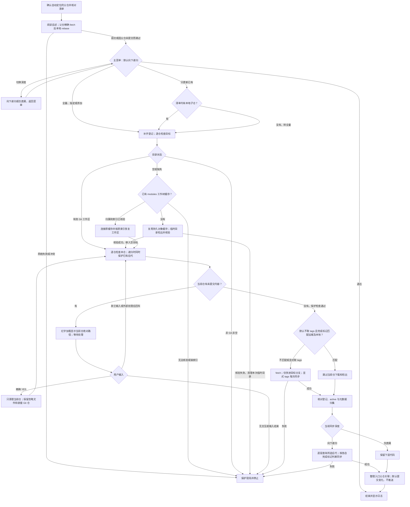

# `【MacOS】⏬下载配置当前Git子模块（可向下同步递归）.command`


<!-- jobs-toc:start -->
<!-- jobs-toc:source {"v":2,"token":"[toc]"} -->
<details>
<summary>📚 目录（点击展开 / 收起）</summary>

- [🔥 前言](#jobs-toc-heading-1)
- [一、快速流程](#quick-flow)
- [二、脚本用途](#jobs-toc-heading-3)
- [三、运行方式](#jobs-toc-heading-4)
- [四、脚本结构](#jobs-toc-heading-5)
- [五、Homebrew 标准](#jobs-toc-heading-6)
- [六、注意事项](#jobs-toc-heading-7)
- [七、流程图](#jobs-toc-heading-8)
- [八、多平台子模块地址](#submodule-address-rules)
  - [8.1、离线回归验证](#jobs-toc-heading-10)

</details>
<!-- jobs-toc:end -->

## <span id="jobs-toc-heading-1" data-jobs-toc="v2">🔥 <font id=前言>前言</font></span><!-- jobs-toc:heading-end -->

- 采用 Shell 脚本的原因：Shell 来自 [**macOS**](https://www.apple.com/macos/) 原生系统底层，虽然写法相对繁琐冗杂，但执行效率高，并且不需要额外介入 [**Ruby**](https://www.ruby-lang.org)、[**Python**](https://www.python.org) 等第三方运行环境，因此具备更好的移植性。
- 本自述文件对应脚本：`【MacOS】⏬下载配置当前Git子模块（可向下同步递归）.command`。
- 脚本原始位置：`JobsGenesis@JobsCommand.Gits`。
- 脚本定位：按父仓选定远端下载、登记和同步 Git 子模块。
- 脚本使用 `# shell: zsh`、内置自述确认、彩色日志与结构化 `main "$@"` 入口。
- 阅读脚本自述后按回车继续，按 `Ctrl+C` 取消；未提交内容按对应仓库的确认提示处理。
- 全量同步复用已有工作区；未提交内容逐仓等待精确 `YES` 或外部处理。目标本地分支只允许快进；本地领先远端或分叉时停止并保留提交，外部整合后重试。

<strong id="markdown-toc-sync">同步后文档目录：本地 `[toc]`，提交后发布折叠目录</strong>

本地编辑保留独占行 `[toc]`；整文件暂存时由 [**Git**](https://git-scm.com/) 过滤器生成按标题层级缩进、默认收起的可折叠目录，正常提交推送后供远端展示。下载入口逐仓检查已生效的 `filter.jobs-markdown-toc` 配置，再决定是否恢复当前工作区；父仓配置不能代替子仓配置。

| 本仓配置与工具 | 同步入口处理 | 结果与依赖 |
| --- | --- | --- |
| 已有有效目录过滤器 | 执行本仓 `.jobs-markdown-toc/MarkdownToc.mjs restore`，再执行 `verify`；已有工作树即使没有新提交，也显式恢复当前正文 | 需要可用的 [**Node.js**](https://nodejs.org) 和完整目录工具；保留正文及原暂存语义 |
| 未配置有效目录过滤器 | 明确跳过目录恢复，不自动安装、注册或改写 Git 配置 | 不额外依赖 Node.js；跳过不代表已有生成目录已恢复为 `[toc]` |
| 已有有效过滤器，但缺少 Node.js / 工具，或还原、验证失败 | 报出具体仓库并停止本轮同步 | 处理该仓配置或工具后重试，不能将本轮视为全部成功 |

默认只拉取的首次克隆先以 `--no-checkout` 复制已预检对象，记录真实远端地址后才首次安全检出，让按真实 URL 匹配的机器过滤器有机会生效；不会为此再次联网获取未经预检的提交。已有生成目录的恢复以当前磁盘正文为来源，不从旧 `HEAD` 或暂存区覆盖正文，也不自动暂存、提交或推送。当前机器尚未注册或换机后没有有效配置时，仍按表中“跳过”处理，不能承诺首次落盘已经是 `[toc]`。

<strong id="readonly-submodule-mode">先选用途：只拉取电脑默认跟随分支最新，子仓保持本地分支</strong>

用途、维护菜单、子仓多选和同步深度统一使用 [**fzf**](https://formulae.brew.sh/formula/fzf)。两种模式启动前都需已有可用 fzf，缺失或损坏时安全停止并提示修复，不自动退回数字菜单。维护菜单按 `←` 返回用途页，子仓与深度页按 `←` 返回维护菜单；返回后保留当前深度并恢复菜单位置。子仓多选用回车勾选 / 取消、空格确认、`Ctrl+A` 全选、`Ctrl+D` 清空；空选不启动同步，`Esc` / `Ctrl+C` 取消本轮。返回只改变后续选择，已经完成的父仓更新不会撤销。

| 启动选择 | 版本依据 | 是否写入父仓提交 |
| --- | --- | --- |
| 只拉取，默认 | 更新当前父仓明确的远程上游，再逐层跟随子仓目标分支最新提交，保持本地跟踪分支 | 不暂存、不提交、不推送 |
| 维护子模块，显式选择 | 按本仓清单及原有菜单，把所选子树更新到各自远端目标分支最新 | 沿用 `AUTO_PARENT_COMMIT` / `AUTO_PARENT_PUSH` 原有开关 |

启动第一屏显示同步策略版本 `2026.10.27-audited`。新电脑须先取得并运行带此版本号的入口；另一台电脑上的本地修改不会自动更新到新电脑。任一仓库拉取、分支切换或递归校验失败时，本轮不能视为全部完成；处理日志中的具体路径后重新运行。

只拉取模式从脚本所在仓库向下递归处理全部已登记子模块；不向上处理，不使用清单新增关联，也不把子仓最新提交自动提交回父仓。各层优先使用直接父仓 `.gitmodules` 的显式 `branch`，`.` 继承该层计划更新后的直接父仓分支；未配置时读取该子仓远端默认分支。首次下载和已有游离 HEAD 都会恢复或创建对应本地跟踪分支，获取最新提交并快进；成功结束时子仓显示实际分支名。每层相对 URL 随当前父仓的下载线路解析。只拉取模式使用系统 Git、zsh、Perl 等现有工具；仅命中有效目录过滤器时另需 Node.js 和该仓完整目录工具，外层用途选择仍需 fzf；只拉取不需要 Homebrew。

子仓源码、未跟踪内容、已暂存 gitlink、未完成操作或本地独有提交会报出具体路径并停止；不会强制覆盖或丢弃独有的游离提交，父仓 `YES` 不扩散到子仓。当前父仓自己的源码改动或本地独有提交，仍须红字列明并精确输入 `YES` 才舍弃。目标分支不存在、远端默认分支无法确定或最新提交获取失败时，停止并报告对应仓库与来源；不会把旧 gitlink SHA 当作最新分支结果。

只拉取模式在入口仓已有本地分支时仍要求明确上游。入口仓自身处于游离 HEAD 时，先使用直接父仓 `.gitmodules` 的显式 `branch`，`.` 继承直接父仓当前分支；无配置时读取 `origin` 或唯一远端的默认分支。已有目标本地分支须明确跟踪所选远端的同名分支；先获取最新提交，预检整棵子树与提交历史，并复查确认期间的状态，再恢复或创建本地跟踪分支。入口源码未提交、需继承分支时直接父仓同样游离、目标不明、目标分支无法快进或存在未受引用保护的独有游离提交时停止；普通父仓的 `YES` 不授权舍弃这些提交。

`REMOTE_NAME` 等原有清单参数只用于维护模式。设置 `DRY_RUN=1` 时，默认只拉取会停止并提示选择维护演练，不能忽略演练标志后执行真实更新。未初始化但存在旧 Git 缓存的空工作树须先恢复，脚本不会覆盖缓存内索引或独有提交。

下文关于清单新增、多选、可切换同步深度、目录清理及自动提交的既有流程，均指显式选择的**维护模式**。只拉取模式默认向下递归到分支最新，不使用这些写入父仓的开关；子仓最新提交与父仓 gitlink 可能不同，父仓会显示待审阅的子模块指针改动。两种模式都保留各仓独立清单和来源显示；两种模式均使用本次私有随机日志，终端会输出实际路径。

<strong id="download-resume-cache">网络不稳定时：保留下载缓存，安全发布工作树</strong>

只拉取与维护模式都会复用已有工作树。首次下载先把目标分支获取到持久裸对象库，再在实际 Git 元数据目录内的本次临时目录以 `--no-checkout` 复制对象、设置真实远端、检出并核验固定提交；全部成功后才移入经过复检的空目标目录。获取或检出失败时只清理本次临时目录，保留持久缓存供重跑使用，不把半成品工作树留在目标位置，不覆盖已有非空目录。已有条件过滤器仍在真实远端配置完成后的首次检出参与转换，不额外联网获取未经预检的提交。

缓存位于实际 Git 目录内的 `jobs-download-cache/v1/<路径与来源哈希>.git`：只拉取统一使用入口仓的 Git 目录，维护模式逐层使用当前父仓的 Git 目录。路径、配置来源与实际展开来源共同区分缓存；成功、失败和正常中断后均保留，不自动清空，所占磁盘空间会持续保留。中断只留下本工具的空缓存目录时可以重新初始化；不明或非空冲突目录保留并停止，不借恢复删除用户内容。

需要同步时正常获取最新分支，已完整下载的对象参与增量协商；后续某仓失败不会清除前面已下载成功的准备对象。**这不是半截 pack 按字节续传**：当前尚未完整接收的 pack 仍可能重新传输。只拉取的首次下载使用 `--depth=1`；维护模式沿用 `SUBMODULE_SHALLOW_CLONE`、`SUBMODULE_DEPTH` 和 `SUBMODULE_FETCH_TAGS`。已有完整仓不改成浅仓，已有工作树更新不重新设置浅克隆深度；浅克隆主要减少历史，当前工作文件中的大包仍须下载。

<strong id="download-complete-marker">每仓完成标记：先查询远端，版本匹配才跳过</strong>

每次运行先用 `ls-remote` 查询目标分支的远端最新提交，再核对该仓实际 Git 目录中的 `jobs-download-complete`。标记记录来源签名（包含配置来源与实际展开 URL 的哈希）、目标分支和已完成提交；本地 `HEAD`、当前分支、远端提交和标记全部匹配，并通过源码风险检查，默认才跳过**当前仓库**的下载与检出。来源哈希避免把带凭据的原始地址写进完成标记。

| 检查结果 | 当前仓库的处理 |
| --- | --- |
| 标记匹配远端最新提交，本地分支 / `HEAD` 和源码状态也符合，且使用默认不取 tags 策略 | 跳过当前仓下载与检出，仍核对或补齐子模块登记、`active` 和 `absorbgitdirs` 元数据归集，再独立检查所选范围内的后代。 |
| 标记不存在、来源 / 分支 / 提交改变，或本地状态与标记不一致 | 进入正常同步及既有风险检查，成功核验后才写入或更新标记。 |
| 已经是最新代码，但此前没有完成标记 | 正常同步一次，核验成功后建立标记，后续运行才可按标记跳过。 |
| 查询远端、下载、检出或核验失败 | 不写本轮成功标记；保留失败状态和下载缓存，处理具体原因后重跑。 |

父仓标记只表示该仓完成，**不表示整棵子树完成**；每个后代仍独立查询与核对。标记不会放宽源码、暂存内容、分叉或独有提交的保护，也不会跳过必要的本地登记修复；发现风险仍按原有门禁停止或确认。维护模式中 `SUBMODULE_FETCH_TAGS=0` 为默认省流量策略；显式设为 `1` 时，每次仍同步 tags，目标分支 `HEAD` 没变也不能被完成标记跳过。完成标记和下载缓存都在 Git 元数据目录内，不生成源码文件或自动提交。

需要强制重新同步某个仓库时，先停止该下载任务，在该仓执行下面的只读命令定位标记，然后只移除这个 `jobs-download-complete` 文件；保留 `modules/`、索引、对象缓存和其它 Git 元数据。移除某个仓的标记只影响该仓，后代仍按各自标记检查：

```shell
git rev-parse --git-path jobs-download-complete
```

| 环境变量 | 默认值 | 允许范围 | 作用 |
| --- | --- | --- | --- |
| `JOBS_DOWNLOAD_TIMEOUT` | `900` | `1–86400` | 单次 Git 网络命令总时限，单位秒；超时终止该命令及其子进程。 |
| `JOBS_DOWNLOAD_ATTEMPTS` | `3` | `1–10` | `clone` / `fetch` / 远端查询遇网络错误时的最多尝试次数，包含首次。 |
| `JOBS_DOWNLOAD_RETRY_DELAY` | `2` | `0–60` | 重试等待基数，默认两次分别等待 2、4 秒；`0` 表示不等待。 |
| `JOBS_DOWNLOAD_LOW_SPEED_LIMIT` | `1024` | `1–1000000000` | HTTP / HTTPS 低速阈值，单位字节 / 秒。 |
| `JOBS_DOWNLOAD_LOW_SPEED_TIME` | `60` | `1–3600` | 持续低于阈值达到此秒数后终止该次传输。 |

参数须为对应范围内的十进制整数，空值、表达式和越界值会停止执行。认证、权限、分支不存在和本地仓库错误保留失败状态，按日志处理后重跑；`pull` 不自动重复合并 / rebase，`push` 不使用下载重试包装。参数只影响本次脚本及其 Git 子进程，不修改全局 HTTP 或代理配置。同一入口通过共用锁阻止并行运行；异常强制结束留下锁时，须先确认旧进程已经退出再处理日志指明的锁目录。

维护模式在父仓工作区可拉取时，只精确 `fetch` 当前目标分支一次，固定本次远端跟踪目标，再在本地 `rebase` 到该目标；不会为了同一次父仓更新再发起 `pull` 的第二次网络获取。远端获取失败或 rebase 冲突会停止本轮，不继续处理子仓。父仓存在未提交内容时继续按原有策略跳过父仓拉取，具体风险与后续所选子仓分别检查。

脚本是可单独复制的完整入口：共享函数在本文件内只维护一份，只拉取流程按明确白名单导出所需函数到独立 zsh 子进程，不依赖外置支持库。两种模式的外层用途选择均要求已有健康的 fzf；只拉取不需要 Homebrew，维护模式仅在 fzf 修复确需且确认后使用 Homebrew，不为拉代码批量升级全部已安装软件。

两种模式的日志都在系统临时目录中使用本次唯一的随机文件名，权限为 `600`；以终端打印的“本次日志”或“日志”完整路径为准，不根据固定名称猜测。来源和诊断按既有规则脱敏。缓存、临时检出目录与完成标记放在 Git 元数据目录内，不进入源码或提交。

在本 README 所在目录运行，下面把单次时限放宽到 30 分钟，其余参数使用默认值；普通使用仍可直接双击脚本。网络慢但持续有数据时可适当提高总时限，避免完整大包尚未传完就达到时限：

```shell
JOBS_DOWNLOAD_TIMEOUT=1800 \
  /bin/zsh './【MacOS】⏬下载配置当前Git子模块（可向下同步递归）.command'
```

终端来源块后会显示 `下载缓存（重跑复用已完成对象）` 及其实际路径。这里的下载对象缓存与 `modules/` 中已有子模块的索引、配置和历史不同；后者仍按原有归属及索引保护规则处理，不能为重试删除它们。

维护模式补齐或新增登记时，不自动写入 `branch = main`；已有 `branch` 与缺省状态均保留。显式 `branch` 严格指定目标分支，`.` 继承直接父仓分支；未配置时跟随子仓远端默认分支。目标不存在、直接父仓分支无法确定或远端默认分支无法确定时停止。

<strong id="sync-worktree-states">维护模式全量同步先看目录状态</strong>

| 本地状态 | 执行结果 | 需要怎样处理 |
| --- | --- | --- |
| 目录为空或缺失，且无既有 Git 缓存 | 首次克隆该子仓，再按所选深度同步。 | 核对清单后开始同步。 |
| 已有有效 Git 工作区，且没有未提交内容 | 复用原目录与缓存；默认不取 tags 时，远端最新提交、完成标记与本地状态匹配可跳过当前仓，否则 `fetch` 后快进目标本地分支。 | 本地领先远端或分叉时停止并保留提交，外部整合后重试。 |
| 当前仓或递归模式下所选子树的已有后代存在未提交、已暂存或未跟踪内容 | 红字加粗显示对应仓库绝对路径，暂停并循环复检。 | 精确输入 `YES` 只放弃该仓自己的内容，或在外部处理后回车复检；其它输入继续等待。 |

全量同步默认保留已有多层子树、旧仓名目录与 Git 缓存。空或缺失目录已有缓存时，先核验并按原索引恢复工作区；非 Git 非空目录、缓存归属不明或缺少索引时保护现场并停止。`YES` 使用 `reset --hard HEAD` 与 `clean -fd`，忽略文件和独立嵌套 Git 仓继续保留；无交互或输入结束时停止。

<strong id="nested-submodule-paths">分类目录中的直属子模块</strong>

本地 `path` 可以包含安全的相对分类目录。例如 `JobsGenesis` 的两端扩展位于 `OS@Extension/MacOS@Extension` 和 `OS@Extension/WindowsOS@Extension`；`OS@Extension` 只是普通目录，两个子模块仍由 `JobsGenesis` 直接管理。维护清单使用完整相对路径，已有 `.gitmodules` section 名可以与 `path` 不同，脚本保留原 section、URL、分支和扩展字段。

首次克隆会准备必要的父分类目录；已有子仓继续原地复用。绝对路径、空路径段、`.` / `..`、`.git`、控制字符、符号链接以及跨过另一独立 Git 仓的路径都会被拒绝。显式裁剪旧登记时，只要旧路径与当前清单路径互为祖先或后代，立即停止，不把公共分类目录当成可删除目标。

<strong id="sync-depth">维护模式先选范围，再按当前深度向下同步</strong>

主菜单默认显示“向下递归”，通过“切换同步深度”可改为“仅直属子模块”；切换后返回主菜单，全量、已有、多选和添加地址都使用当前深度。退出菜单不要求先选择深度。

| 同步深度 | 实际处理范围 |
| --- | --- |
| 向下递归，默认 | 本层所选子仓，以及各层 `.gitmodules` 登记的全部后代；逐层追踪各自远端目标分支最新提交。 |
| 仅直属子模块 | 只下载或更新本层所选子仓，不下载或更新其内部子模块代码。 |

以脚本所在仓库为起点：脚本位于仓库根目录或直属同名脚本包时都定位到该仓，不向更高父仓扫描。多选只展开勾选项的子树；未登记的嵌套 Git 仓库不接管。深层只下载更新，不自动暂存或提交 gitlink，因此其直接父仓可能保留子模块指针改动；入口父仓仍沿用原有自动提交开关。

仅直属模式限制代码下载更新：已有标准 `.git` 指针时跳过元数据归集；首次将独立 `.git` 目录纳入子模块时，Git 的 `absorbgitdirs` 仍可能整理后代元数据，但不会因此下载下层代码。

<strong id="git-source-log">运行时先看这里：子 Git 从哪里拉取</strong>

以父仓线路为 `https://gitee.com/JobsGo/JobsGenesis.git`、下载 `JobsCommand@iOS` 为例，终端会突出显示完整来源；提交号仅展示成功日志的格式：

```text
━━━━━━━━━━ Git 来源｜首次克隆 ━━━━━━━━━━
📦 仓库：JobsCommand@iOS
🌐 平台 / 主机：Gitee（gitee.com）
📥 拉取地址：https://gitee.com/JobsGo/JobsCommand-iOS.git
━━━━━━━━━━━━━━━━━━━━━━━━━━━━━━━━━━━━━━
ℹ️  克隆分支：main
ℹ️  下载缓存（重跑复用已完成对象）：<父仓实际 Git 目录>/jobs-download-cache/v1/<路径与来源哈希>.git
... Git 原生下载进度 ...
✅ JobsCommand@iOS 已浅同步到 origin/main：17b467d（来源：https://gitee.com/JobsGo/JobsCommand-iOS.git）
```

父仓线路、首次克隆和拉取更新各有来源块；递归模式在取得每层 `.gitmodules` 后，先显示下层子仓来源，再逐项下载更新。每层都使用其直接父仓地址解析相对 URL。平台按地址中的主机识别，不按本地目录名判断。

若 `insteadOf` 改写了 URL，来源块同时列出“解析地址”和“拉取地址”；后者由 `git ls-remote --get-url` 在本地展开，未探测 HTTP 重定向或代理最终出口。首次克隆只读取系统、全局及本次进程的规则，不沿用父仓本地 `insteadOf`；已有子仓拉取读取自身配置，递归子仓也分别按未初始化 / 已初始化采用这两种作用域。新来源块在支持颜色的终端重点显示，写入日志时保留纯文本；URL 凭据与查询参数会脱敏。来源日志位于系统临时目录，文件名带本次随机后缀、权限为 `600`，以终端打印的实际路径为准，Git 原生进度仍以终端输出为准。

## 一、<span id="quick-flow">快速流程</span> <a href="#前言" style="font-size:17px; color:green;"><b>🔼</b></a> <a href="#🔚" style="font-size:17px; color:green;"><b>🔽</b></a>

- 1、在父仓根目录或其直属同名脚本包中运行，确认脚本自动定位的父仓，并核对 `SUBMODULE_REPO_URLS`。

- 2、阅读自述后继续；脚本准备父仓远端与分支，尝试拉取父仓，再检查菜单依赖。
  - 如果父仓有未提交改动，按既有策略跳过父仓获取与 rebase；网络失败或 rebase 冲突则停止，不继续子仓。

- 3、在主菜单选择同步范围；“切换同步深度”可在默认“向下递归”和“仅直属子模块”之间切换，当前深度适用于各同步动作。
  - 如果选全量模式，逐项同步清单内全部目标，按目录状态复用或首次克隆。
  - 如果选“只更新目前已有的”，只处理清单内已存在的子仓；一个也没有时转入全量模式。
  - 如果选“选择指定子模块同步”，勾选后按空格确认。

- 4、先补齐 `.gitmodules` 缺项，再处理目录。
  - 空或缺失目录首次克隆，已有有效 Git 工作区先核对远端最新提交、完成标记与本地状态，默认不取 tags 且匹配时跳过当前仓，否则原地更新；既有缓存先核验并恢复空工作区，非 Git 非空目录保护并停止。

- 5、克隆缺失子仓；已有子仓先核对远端最新提交、完成标记与本地状态，默认不取 tags 且匹配时跳过当前仓，否则执行 `fetch`，切换或创建目标本地跟踪分支后仅快进更新。拉取并快进到远端目标分支最新提交：优先使用该层 `.gitmodules` 显式 `branch`，`.` 继承直接父仓分支；未设置时读取该子仓远端默认分支；显式目标分支不存在时立即停止，不回退其它分支。
  - 子仓有未提交、已暂存或未跟踪内容：红字加粗显示该仓绝对路径并循环等待；精确输入 `YES` 只放弃当前仓自己的未提交内容，或在外部处理后回车复检。其它输入继续复检；无交互或输入结束则停止。本地目标分支领先远端或分叉时停止并保留提交，外部整合后重试。

- 6、按当前深度同步：默认逐层读取所选子仓下的 `.gitmodules`，将已登记后代同步到各自远端目标分支最新提交；仅直属模式不下载或更新下层代码。
  - 只处理本层所选子树，不向上扫描，也不接管未登记的嵌套仓库。
  - 递归更新本层前先检查当前已有后代；各仓单独确认，子模块 HEAD 与父仓 gitlink 的普通差异不作为源码未提交反复提示。
  - `YES` 清理仅作用于当前仓：`reset --hard HEAD` 与 `clean -fd`；保留忽略文件和独立嵌套 Git 仓，残留冲突须外部处理后复检。
  - `PRUNE_STALE_GITMODULES` 默认 `0`，保留清单外旧登记；主动设为 `1` 时，每个旧登记另用红字加粗列明目录和后代删除范围，逐项精确输入 `YES` 才删除，其它输入、输入结束或非交互则停止；演练只展示，删除前仍逐仓检查已有后代。
  - 深层只下载更新，不自动暂存或提交其父仓的 gitlink；递归后这些父仓可能显示子模块指针改动，保留待审阅。

- 7、整理入口父仓关联并更新指针；默认有变化就自动提交入口父仓，不自动推送。
  - 如果要保留修改待审查，运行前设置 `AUTO_PARENT_COMMIT=0`；自动推送开关默认 `AUTO_PARENT_PUSH=0`。

**目的：** 下载或更新清单内子仓到所选远端分支的最新提交，并同步父仓记录。

<strong id="submodule-quick-look">先看例子：同一份子模块配置，跟着父仓走不同平台</strong>

以下用 `JobsGenesis` 父仓中已有的 `JobsCommand@Flutter` 子模块演示本通用工具的地址规则。

明确使用 [**GitHub**](https://github.com) 绝对地址的写法：

```ini
url = https://github.com/JobsKits/JobsCommand-Flutter.git
```

同平台、同组织时，共享配置优先使用以下相对地址：

```ini
[submodule "JobsCommand@Flutter"]
    path = JobsCommand@Flutter
    url = ../JobsCommand-Flutter.git
    branch = main
```

同一条 `url` 根据父仓地址解析，支持 [**Gitee**](https://gitee.com) 和任意自建平台；自建地址仅作示例：

| 所选父仓 remote 地址 | 子仓实际地址 |
| --- | --- |
| `https://github.com/JobsKits/JobsGenesis.git` | `https://github.com/JobsKits/JobsCommand-Flutter.git` |
| `https://gitee.com/JobsGo/JobsGenesis.git` | `https://gitee.com/JobsGo/JobsCommand-Flutter.git` |
| `ssh://git@git.example.com:2222/team/tools/JobsGenesis.git` | `ssh://git@git.example.com:2222/team/tools/JobsCommand-Flutter.git` |

`path` 是本地目录名，`url` 中必须写真实远端仓名；`JobsCommand@Flutter` 与 `JobsCommand-Flutter.git` 可以不同。目标平台必须已有子仓镜像，并包含父仓 gitlink 指定的提交。

维护模式用 `REMOTE_NAME` 选择父仓线路，默认 `origin`；例如父仓已有 `gitee` remote 时，`REMOTE_NAME=gitee` 让相对 URL 按该地址解析。已有绝对 URL 例外仍按其明确地址下载，脚本保留它，不会因选了 `gitee` 就强行替换。新登记缺少目标平台真实地址证据时会停止；完整参数见[多平台子模块地址](#submodule-address-rules)。

**下载脚本的 Gitee 传输规则：** `【MacOS】⏬下载配置当前Git子模块（可向下同步递归）.command` 在本次运行中，将 `git@gitee.com:`、`ssh://git@gitee.com/`、`ssh://git@gitee.com:22/` 开头的标准地址统一通过 `https://gitee.com/` 访问，保留账号、真实仓名和分支；即使设置 `GIT_URL_STYLE=ssh`，这类 Gitee 地址仍使用 HTTPS。各层首次克隆和后续拉取都继承该规则，历史子模块中的 SSH 地址无需新电脑先配置 SSH 密钥。

规则通过追加进程级 `GIT_CONFIG_COUNT` / `url.https://gitee.com/.insteadOf` 配置传给子进程，不写入全局 Git 配置，也不依赖其它工程路径。GitHub、其它主机及非 `22` 的自定义 SSH 端口保持原规则。克隆或递归更新失败会返回非零状态，停止本轮同步并保留错误；不会再输出该项同步成功。各仓清单与浅克隆参数保留；全量同步默认逐仓复用已有工作区，空或缺失目录才首次克隆，不批量删除旧仓名目录、多层子树或缓存。未提交内容须逐仓处理，精确 `YES` 仅放弃当前仓自己的内容。

## <span id="jobs-toc-heading-3" data-jobs-toc="v2">二、脚本用途 <a href="#前言" style="font-size:17px; color:green;"><b>🔼</b></a> <a href="#🔚" style="font-size:17px; color:green;"><b>🔽</b></a></span><!-- jobs-toc:heading-end -->

| 项目 | 说明 |
|---|---|
| 脚本名称 | `【MacOS】⏬下载配置当前Git子模块（可向下同步递归）.command` |
| 所属目录 | `JobsGenesis@JobsCommand.Gits` |
| 主要标签 | `Git` |
| 是否涉及 Homebrew | `是` |
| 是否可能联网 | `是` |
| 是否含高风险命令 | `是` |
| zsh 静态检查 | `已通过 zsh -n，未执行真实下载` |

## <span id="jobs-toc-heading-4" data-jobs-toc="v2">三、运行方式 <a href="#前言" style="font-size:17px; color:green;"><b>🔼</b></a> <a href="#🔚" style="font-size:17px; color:green;"><b>🔽</b></a></span><!-- jobs-toc:heading-end -->

脚本支持直接放在目标父仓根目录，也支持保留在直属同名脚本包内。此处直接运行会自动定位上层 `JobsCommand@Gits`；先核对内置 `SUBMODULE_REPO_URLS`，避免同步错误的目标清单。

准备好后，双击脚本，或在本脚本包目录执行：

```shell
chmod +x './【MacOS】⏬下载配置当前Git子模块（可向下同步递归）.command'
'./【MacOS】⏬下载配置当前Git子模块（可向下同步递归）.command'
```

脚本启动后会先显示内置自述，并等待回车继续，避免误触执行。

进入“选择指定子模块同步（可多选）”后，用 ↑ / ↓ 移动，按回车（Enter）勾选或取消项目；最后按 **空格键（Space）确认并开始同步**，无需再按回车。列表底部会持续显示操作提示；按 ← 返回上一页。

## <span id="jobs-toc-heading-5" data-jobs-toc="v2">四、脚本结构 <a href="#前言" style="font-size:17px; color:green;"><b>🔼</b></a> <a href="#🔚" style="font-size:17px; color:green;"><b>🔽</b></a></span><!-- jobs-toc:heading-end -->

- 使用系统 `/bin/zsh`，先显示内置自述并等待确认。
- `main` 编排环境检查、父仓定位、菜单和同步，各步骤由独立函数完成。
- 每份脚本独立携带依赖自检、来源日志与业务实现；各仓清单保留，共同逻辑保持一致。
- 日志位于系统临时目录，文件名带本次随机后缀、权限为 `600`，以终端打印的实际路径为准。

## <span id="jobs-toc-heading-6" data-jobs-toc="v2">五、Homebrew 标准 <a href="#前言" style="font-size:17px; color:green;"><b>🔼</b></a> <a href="#🔚" style="font-size:17px; color:green;"><b>🔽</b></a></span><!-- jobs-toc:heading-end -->

- 已有 Homebrew 时保留原有维护交互，不因目录只读而自动另装。
- [**Homebrew**](https://brew.sh/) 安装路径由用户选择：已有可运行安装时复用；确实需要安装时先强提示，只有精确输入大写 `YES` 才选择系统标准目录，其它输入或直接回车选择当前用户的 `.local/homebrew`。`YES` 只表示选择路径，权限与密码由官方安装器实际处理；有管理员权限也可以选用户目录。选定路径失败立即停止，不自动切换；`Ctrl+C` / 输入结束取消整个任务。
- 用户目录安装需要可用 Git 与 curl；后续系统级软件仍可能要求管理员权限。

## <span id="jobs-toc-heading-7" data-jobs-toc="v2">六、注意事项 <a href="#前言" style="font-size:17px; color:green;"><b>🔼</b></a> <a href="#🔚" style="font-size:17px; color:green;"><b>🔽</b></a></span><!-- jobs-toc:heading-end -->

- 我没有在生成阶段执行脚本里的 macOS 专属命令，例如 `brew`、`pod`、`flutter`、`xcodebuild`、`osascript`、`sudo`、模拟器控制等。
- 首次运行前建议先阅读本 README，再执行脚本。
- 处理目录由脚本位置自动定位：仓库根目录或直属同名脚本包；不使用拖入路径，运行前确认显示的父仓。
- 全量模式逐项复用已有有效 Git 工作区，空或缺失目录才首次克隆；保留对应旧仓名目录、多层子树和缓存。非 Git 非空目录保护并停止。
- 如果脚本涉及 Git / CocoaPods / Flutter 依赖更新，建议先提交或备份本地改动。
- 脚本日志写入系统临时目录，文件名带本次随机后缀、权限为 `600`，以终端打印的实际路径为准；新来源块为纯文本，Git 原生进度以终端输出为准。

工作目录为空或缺失但已有 `modules/` 缓存时，脚本先核验缓存归属，再连接原缓存并按原索引恢复工作区，保留提交、配置和暂存内容，随后进入同样的逐仓检查。缓存缺少索引、归属不明或目标目录非空冲突时保留现场并停止，请先用 Git 处理后重试。

## <span id="jobs-toc-heading-8" data-jobs-toc="v2">七、流程图 <a href="#前言" style="font-size:17px; color:green;"><b>🔼</b></a> <a href="#🔚" style="font-size:17px; color:green;"><b>🔽</b></a></span><!-- jobs-toc:heading-end -->

以下流程图说明显式维护模式，操作目录均指脚本自动定位的父仓根目录；同步失败会中断本轮，已完成的对象缓存和已核验发布的工作树会保留。只拉取使用相同下载保护与逐仓标记，执行已登记子树的安全同步，不进入父仓自动提交流程。



## 八、<span id="submodule-address-rules">多平台子模块地址</span> <a href="#前言" style="font-size:17px; color:green;"><b>🔼</b></a> <a href="#🔚" style="font-size:17px; color:green;"><b>🔽</b></a>

- 支持 [**GitHub**](https://github.com)、[**Gitee**](https://gitee.com)、[**GitLab**](https://about.gitlab.com) 和自建 Git 服务器；接受 HTTPS、`git@host:namespace/repo.git` 和 `ssh://git@host:端口/namespace/repo.git`，保留嵌套 namespace 与显式端口。配置中禁止携带 HTTP 用户凭据或 SSH 密码。
- `REMOTE_NAME` 默认 `origin`。已有 `.gitmodules` 的 URL、分支、缺省分支和扩展字段保持原样；`../真实仓名.git` 随所选父 remote 的平台、namespace、协议与端口解析，仓名不从本地目录猜测。
- 新条目依据真实子仓 remote 与父 remote 的对应关系生成相对 URL。已知镜像仓名不同、跨组织或端口不匹配时保留已确认的绝对地址；缺少目标平台地址证据时停止并提示在 `.gitmodules` 配置真实 URL，不自动退回其它平台。
- 递归同步逐层使用各自父仓地址。绝对子仓下面的相对子模块，以该绝对子仓为基准继续解析。
- Gitee 标准地址统一使用 HTTPS；其它地址在 `GIT_URL_STYLE=auto` 时保留实际地址，显式指定 `https` 或 `ssh` 只转换无歧义地址，无法推断跨协议端口时停止。`AUTO_PARENT_COMMIT` 默认 `1`，`AUTO_PARENT_PUSH` 默认 `0`；需要只同步并保留修改待检查时，将自动提交设为 `0`。

父仓已配置名为 `gitee` 的 remote 时，可以在脚本所在目录运行：

```shell
REMOTE_NAME=gitee \
AUTO_PARENT_COMMIT=0 \
./【MacOS】⏬下载配置当前Git子模块（可向下同步递归）.command
```

普通 `git clone --recurse-submodules` 由 Git 依据父仓默认 remote 解析相对 URL；`REMOTE_NAME` 是本脚本的线路选择参数。

### <span id="jobs-toc-heading-10" data-jobs-toc="v2">8.1、离线回归验证 <a href="#前言" style="font-size:17px; color:green;"><b>🔼</b></a> <a href="#🔚" style="font-size:17px; color:green;"><b>🔽</b></a></span><!-- jobs-toc:heading-end -->

需要 `python3`、`zsh` 和 `git`，并保留 `JobsGenesis` 及同级 `JobsBaseConfig` 中 7 份下载入口的目录结构。在本脚本与 `README.md` 所在目录运行：

```shell
python3 -B \
  -m unittest discover \
  -s ./tests \
  -p 'test_*.py'
```

测试仅在临时仓使用本地协议、隔离 Git 配置与受控命令替身，覆盖地址与来源日志、根目录和脚本包定位、同步深度切换、多层分支递归与所选子树边界、已有工作区复用、空目录首次克隆、逐仓 `YES` 与外部处理复检、非交互停止、缓存恢复及归属、异名 section、失败返回及无关暂存内容保留；不访问真实远端，不修改业务仓或全局 Git 配置。测试通过仅表示离线回归通过，新电脑真实下载仍须使用更新后的入口验收。

`./tests/test_download_resume.py` 进一步覆盖持久对象缓存跨失败复用、远端 SHA 变化导致完成标记失效、匹配标记跳过当前仓同步但仍检查后代，以及网络重试、认证失败不重试、超时、信号退出、日志脱敏与锁生命周期。上述案例仍使用隔离仓库或受控命令，不以测试成功代替真实网络下载验收。

`./tests/test_download_transport_tty.py` 的两项真实隔离 PTY 测试验证认证交互，以及 `Ctrl+C` 中断传输后的进程清理和终端恢复；不使用真实远端或业务仓库。

`./tests/test_download_audit.py` 覆盖中断后补齐登记、首次检出失败重跑、索引隐藏内容保护、分支未变时的 tags 同步及空缓存恢复；`./tests/test_download_transport_audit.py` 覆盖远端查询失败时丢弃部分输出、一次查询同时确定分支与 SHA、歧义结果拒绝，以及真实维护入口的锁释放与竞争保护。测试依赖和独立运行命令见 [tests 说明](./tests/README.md)。

<a id="🔚" href="#前言" style="font-size:17px; color:green; font-weight:bold;">我是有底线的➤点我回到首页</a>
