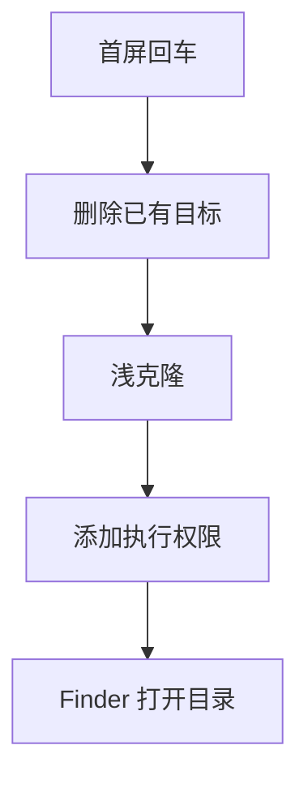

# `【MacOS】⏬双击下载SourceTree效率脚本.command`


<!-- jobs-toc:start -->
<!-- jobs-toc:source {"v":2,"token":"[toc]"} -->
<details>
<summary>📚 目录（点击展开 / 收起）</summary>

- [🔥 前言](#jobs-toc-heading-1)
- [一、功能覆盖](#jobs-toc-heading-2)
- [二、运行方式](#jobs-toc-heading-3)
- [三、输入、选项与结果](#jobs-toc-heading-4)
- [四、环境与依赖](#jobs-toc-heading-5)
- [五、副作用、限制与日志](#jobs-toc-heading-6)
- [六、操作流程](#jobs-toc-heading-7)

</details>
<!-- jobs-toc:end -->

## <span id="jobs-toc-heading-1" data-jobs-toc="v2">🔥 <font id=前言>前言</font></span><!-- jobs-toc:heading-end -->

- 采用 Shell 脚本的原因：Shell 来自 [**macOS**](https://www.apple.com/macos/) 原生系统底层，虽然写法相对繁琐冗杂，但执行效率高，并且不需要额外介入 [**Ruby**](https://www.ruby-lang.org)、[**Python**](https://www.python.org) 等第三方运行环境，因此具备更好的移植性。
- 本自述文件对应脚本：`【MacOS】⏬双击下载SourceTree效率脚本.command`。
- 脚本位置：本目录中的同名 `.command`，从当前 README 所在目录运行。
- 脚本定位：重新下载 SourceTree 效率脚本库，并为脚本添加执行权限。

## <span id="jobs-toc-heading-2" data-jobs-toc="v2">一、功能覆盖 <a href="#前言" style="font-size:17px; color:green;"><b>🔼</b></a> <a href="#🔚" style="font-size:17px; color:green;"><b>🔽</b></a></span><!-- jobs-toc:heading-end -->

| 范围 | 当前能力 |
| --- | --- |
| 目标 | 重新下载 SourceTree 效率脚本库，并为脚本添加执行权限。 |
| 能力 | 来源固定为 `https://github.com/JobsKits/SourceTree.sh.git`，目标是当前用户目录下的 `SourceTree.command`；进入业务后直接删除已有目标目录，再执行 `git clone --depth=1`；只保留浅克隆历史。 |
| 说明入口 | [同名主脚本](./【MacOS】⏬双击下载SourceTree效率脚本.command) |

## <span id="jobs-toc-heading-3" data-jobs-toc="v2">二、运行方式 <a href="#前言" style="font-size:17px; color:green;"><b>🔼</b></a> <a href="#🔚" style="font-size:17px; color:green;"><b>🔽</b></a></span><!-- jobs-toc:heading-end -->

推荐双击 `.command` 运行。终端方式如下：

```shell
chmod +x './【MacOS】⏬双击下载SourceTree效率脚本.command'
'./【MacOS】⏬双击下载SourceTree效率脚本.command'
```

脚本启动后显示内置说明并等待回车。后续选择与确认以本 README 的实际功能和副作用章节为准。

## <span id="jobs-toc-heading-4" data-jobs-toc="v2">三、输入、选项与结果 <a href="#前言" style="font-size:17px; color:green;"><b>🔼</b></a> <a href="#🔚" style="font-size:17px; color:green;"><b>🔽</b></a></span><!-- jobs-toc:heading-end -->

> **目的：** 重新下载 SourceTree 效率脚本库，并为脚本添加执行权限。

- 来源固定为 `https://github.com/JobsKits/SourceTree.sh.git`，目标是当前用户目录下的 `SourceTree.command`。
- 进入业务后直接删除已有目标目录，再执行 `git clone --depth=1`；只保留浅克隆历史。
- 递归对下载库中的 `.sh`、`.command` 文件添加执行权限。
- 完成后用 Finder 打开目标目录；不运行新脚本，也不安装 SourceTree 菜单。

## <span id="jobs-toc-heading-5" data-jobs-toc="v2">四、环境与依赖 <a href="#前言" style="font-size:17px; color:green;"><b>🔼</b></a> <a href="#🔚" style="font-size:17px; color:green;"><b>🔽</b></a></span><!-- jobs-toc:heading-end -->

需要 macOS Git、find、chmod、open 和可访问的 GitHub 网络；没有分支、镜像或目标目录参数菜单。

## <span id="jobs-toc-heading-6" data-jobs-toc="v2">五、副作用、限制与日志 <a href="#前言" style="font-size:17px; color:green;"><b>🔼</b></a> <a href="#🔚" style="font-size:17px; color:green;"><b>🔽</b></a></span><!-- jobs-toc:heading-end -->

- **源码没有目标备份、YES 二次确认或失败回滚。** 首屏回车之后，目标已有内容及 Git 元数据会被删除，克隆失败也不会恢复。
- 先自行完整备份目标，再运行；不能依靠本脚本保留自定义代码或未提交修改。
- 运行结束应核对实际目标与 clone 退出码；需要的自定义菜单另用库内安装器。
- 日志为系统临时目录中的 `【MacOS】⏬双击下载SourceTree效率脚本.log`，以脚本结束时打印的实际位置为准。脚本未保证业务命令全部 stdout / stderr 都写入日志。
- 本文按源码静态核对；没有执行真实创建、安装、删除、提交、密钥配置或远端操作。

## <span id="jobs-toc-heading-7" data-jobs-toc="v2">六、操作流程 <a href="#前言" style="font-size:17px; color:green;"><b>🔼</b></a> <a href="#🔚" style="font-size:17px; color:green;"><b>🔽</b></a></span><!-- jobs-toc:heading-end -->



<a id="🔚" href="#前言" style="font-size:17px; color:green; font-weight:bold;">我是有底线的➤点我回到首页</a>
