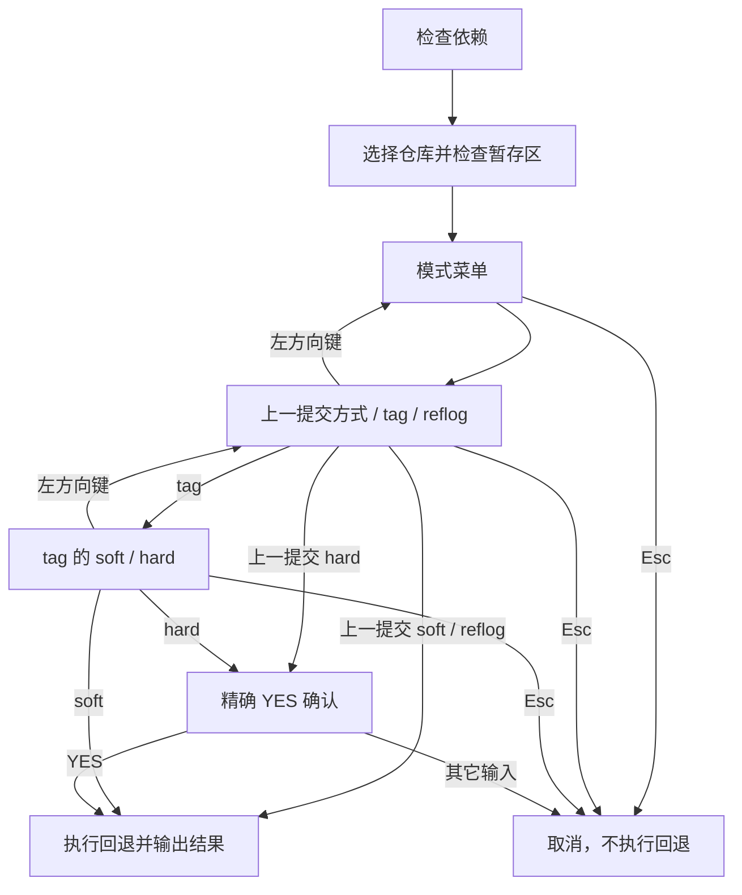

# `【MacOS】♻️双击Git 提交回退.command`


<!-- jobs-toc:start -->
<!-- jobs-toc:source {"v":2,"token":"[toc]"} -->
<details>
<summary>📚 目录（点击展开 / 收起）</summary>

- [🔥 前言](#jobs-toc-heading-1)
- [一、功能覆盖](#jobs-toc-heading-2)
- [二、运行方式](#jobs-toc-heading-3)
- [三、输入、选项与结果](#jobs-toc-heading-4)
- [四、环境与依赖](#jobs-toc-heading-5)
- [五、副作用、限制与日志](#jobs-toc-heading-6)
- [六、操作流程](#jobs-toc-heading-7)

</details>
<!-- jobs-toc:end -->

## <span id="jobs-toc-heading-1" data-jobs-toc="v2">🔥 <font id=前言>前言</font></span><!-- jobs-toc:heading-end -->

- 采用 Shell 脚本的原因：Shell 来自 [**macOS**](https://www.apple.com/macos/) 原生系统底层，虽然写法相对繁琐冗杂，但执行效率高，并且不需要额外介入 [**Ruby**](https://www.ruby-lang.org)、[**Python**](https://www.python.org) 等第三方运行环境，因此具备更好的移植性。
- 本自述文件对应脚本：`【MacOS】♻️双击Git 提交回退.command`。
- 脚本位置：本目录中的同名 `.command`，从当前 README 所在目录运行。
- 脚本定位：通过 fzf 选择上一提交、tag 或 reflog，并执行 Git 本地回退。

## <span id="jobs-toc-heading-2" data-jobs-toc="v2">一、功能覆盖 <a href="#前言" style="font-size:17px; color:green;"><b>🔼</b></a> <a href="#🔚" style="font-size:17px; color:green;"><b>🔽</b></a></span><!-- jobs-toc:heading-end -->

| 范围 | 当前能力 |
| --- | --- |
| 目标 | 通过 fzf 选择上一提交、tag 或 reflog，并执行 Git 本地回退。 |
| 能力 | 检查 / 安装 Homebrew、fzf，选择脚本所在 Git 根或拖入仓库；只接受 `.git` 目录形式的仓库；发现暂存区已有变更时停止，要求先处理暂存内容。 |
| 说明入口 | [同名主脚本](<./【MacOS】♻️双击Git 提交回退.command>) |

## <span id="jobs-toc-heading-3" data-jobs-toc="v2">二、运行方式 <a href="#前言" style="font-size:17px; color:green;"><b>🔼</b></a> <a href="#🔚" style="font-size:17px; color:green;"><b>🔽</b></a></span><!-- jobs-toc:heading-end -->

推荐双击 `.command` 运行。终端方式如下：

```shell
chmod +x './【MacOS】♻️双击Git 提交回退.command'
'./【MacOS】♻️双击Git 提交回退.command'
```

脚本启动后显示内置说明并等待回车。后续选择与确认以本 README 的实际功能和副作用章节为准。

## <span id="jobs-toc-heading-4" data-jobs-toc="v2">三、输入、选项与结果 <a href="#前言" style="font-size:17px; color:green;"><b>🔼</b></a> <a href="#🔚" style="font-size:17px; color:green;"><b>🔽</b></a></span><!-- jobs-toc:heading-end -->

> **目的：** 通过 fzf 选择上一提交、tag 或 reflog，并执行 Git 本地回退。

- 检查 / 安装 Homebrew、fzf，选择脚本所在 Git 根或拖入仓库；只接受 `.git` 目录形式的仓库。
- 发现暂存区已有变更时停止，要求先处理暂存内容。
- 模式菜单为根层，回车进入“上一提交 / tag / reflog”；各子层 header 均显示 `← 返回上一层`，左方向键返回真正的前一选择层。返回时保留仍有效的查询和上层位置，重新选择目标后重新选择对应回退方式。
- “上一提交”可选 `soft` 或 `hard`，目标为 `HEAD^`，左方向键返回模式菜单。
- “tag”先按标签选择目标，再选择 soft / hard；方式面板左键返回 tag 列表，tag 列表左键返回模式菜单。“reflog”选择记录后固定 soft，列表左键返回模式菜单。
- 任意选择层按 `Esc` 取消整个回退流程；空选也不执行回退。没有 tag / reflog 时提示并返回模式菜单；fzf 或 Git 执行失败保留失败状态。
- 选择全部完成后才执行一次回退；hard 额外要求精确输入大写 `YES`。返回、取消和确认不通过均不执行回退；结果写入同名临时日志。

## <span id="jobs-toc-heading-5" data-jobs-toc="v2">四、环境与依赖 <a href="#前言" style="font-size:17px; color:green;"><b>🔼</b></a> <a href="#🔚" style="font-size:17px; color:green;"><b>🔽</b></a></span><!-- jobs-toc:heading-end -->

需要 Git、Homebrew、fzf 与交互 TTY。Homebrew 会增补当前用户相应 Shell 的 shellenv；安装及升级可能联网。

## <span id="jobs-toc-heading-6" data-jobs-toc="v2">五、副作用、限制与日志 <a href="#前言" style="font-size:17px; color:green;"><b>🔼</b></a> <a href="#🔚" style="font-size:17px; color:green;"><b>🔽</b></a></span><!-- jobs-toc:heading-end -->

- **hard 会丢弃已跟踪工作区及暂存改动，必须精确输入大写 `YES` 才执行；其它输入取消。** 脚本不先创建恢复分支。
- soft 移动 HEAD 并保留差异到暂存区；脚本不执行 push、不撤销远端提交。
- 已有 fzf 分支会执行 `brew upgrade fzf` 和 cleanup；Homebrew 总体 update/upgrade 的询问则回车跳过、非空执行。
- 仓库路径读取和 `.git` 目录门禁存在限制；子模块 / linked worktree 的 `.git` 指针不能按已支持描述。
- 日志为系统临时目录中的 `【MacOS】♻️双击Git 提交回退.log`，以脚本结束时打印的实际位置为准。脚本未保证业务命令全部 stdout / stderr 都写入日志。
- 选择流程已做隔离导航验证；没有执行真实回退、安装、升级或远端操作。

## <span id="jobs-toc-heading-7" data-jobs-toc="v2">六、操作流程 <a href="#前言" style="font-size:17px; color:green;"><b>🔼</b></a> <a href="#🔚" style="font-size:17px; color:green;"><b>🔽</b></a></span><!-- jobs-toc:heading-end -->



<a id="🔚" href="#前言" style="font-size:17px; color:green; font-weight:bold;">我是有底线的➤点我回到首页</a>
