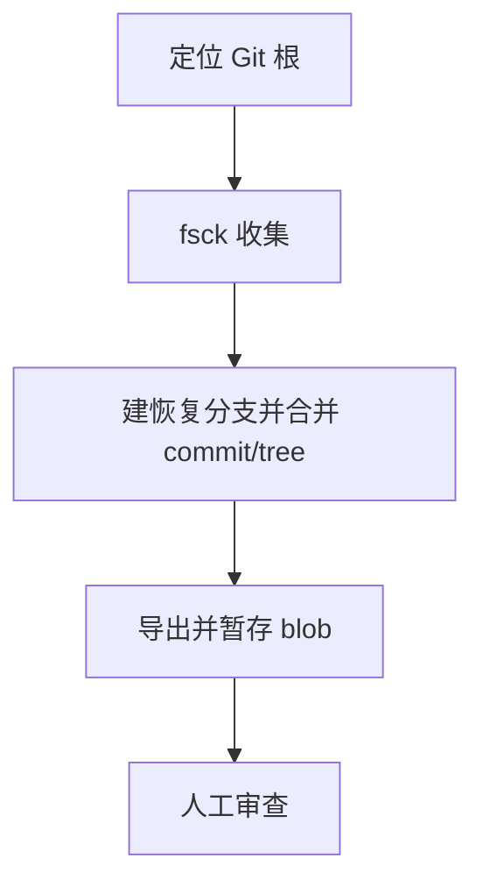

# `【MacOS】♻️双击恢复误删本地Git已储藏的资料.command`


<!-- jobs-toc:start -->
<!-- jobs-toc:source {"v":2,"token":"[toc]"} -->
<details>
<summary>📚 目录（点击展开 / 收起）</summary>

- [🔥 前言](#jobs-toc-heading-1)
- [一、功能覆盖](#jobs-toc-heading-2)
- [二、运行方式](#jobs-toc-heading-3)
- [三、输入、选项与结果](#jobs-toc-heading-4)
- [四、环境与依赖](#jobs-toc-heading-5)
- [五、副作用、限制与日志](#jobs-toc-heading-6)
- [六、操作流程](#jobs-toc-heading-7)

</details>
<!-- jobs-toc:end -->

## <span id="jobs-toc-heading-1" data-jobs-toc="v2">🔥 <font id=前言>前言</font></span><!-- jobs-toc:heading-end -->

- 采用 Shell 脚本的原因：Shell 来自 [**macOS**](https://www.apple.com/macos/) 原生系统底层，虽然写法相对繁琐冗杂，但执行效率高，并且不需要额外介入 [**Ruby**](https://www.ruby-lang.org)、[**Python**](https://www.python.org) 等第三方运行环境，因此具备更好的移植性。
- 本自述文件对应脚本：`【MacOS】♻️双击恢复误删本地Git已储藏的资料.command`。
- 脚本位置：本目录中的同名 `.command`，从当前 README 所在目录运行。
- 脚本定位：搜寻 Git dangling 对象，并尝试恢复 commit、tree 与 blob。

## <span id="jobs-toc-heading-2" data-jobs-toc="v2">一、功能覆盖 <a href="#前言" style="font-size:17px; color:green;"><b>🔼</b></a> <a href="#🔚" style="font-size:17px; color:green;"><b>🔽</b></a></span><!-- jobs-toc:heading-end -->

| 范围 | 当前能力 |
| --- | --- |
| 目标 | 搜寻 Git dangling 对象，并尝试恢复 commit、tree 与 blob。 |
| 能力 | 从脚本所在目录定位 Git 根，执行 `git fsck --lost-found`，把对象清单暂存到工作树 `.fsck_temp`；每个 dangling commit 创建 `recovered-commit-<SHA>` 分支，再自动尝试合并到当前分支。 |
| 说明入口 | [同名主脚本](./【MacOS】♻️双击恢复误删本地Git已储藏的资料.command) |

## <span id="jobs-toc-heading-3" data-jobs-toc="v2">二、运行方式 <a href="#前言" style="font-size:17px; color:green;"><b>🔼</b></a> <a href="#🔚" style="font-size:17px; color:green;"><b>🔽</b></a></span><!-- jobs-toc:heading-end -->

推荐双击 `.command` 运行。终端方式如下：

```shell
chmod +x './【MacOS】♻️双击恢复误删本地Git已储藏的资料.command'
'./【MacOS】♻️双击恢复误删本地Git已储藏的资料.command'
```

脚本启动后显示内置说明并等待回车。后续选择与确认以本 README 的实际功能和副作用章节为准。

## <span id="jobs-toc-heading-4" data-jobs-toc="v2">三、输入、选项与结果 <a href="#前言" style="font-size:17px; color:green;"><b>🔼</b></a> <a href="#🔚" style="font-size:17px; color:green;"><b>🔽</b></a></span><!-- jobs-toc:heading-end -->

> **目的：** 搜寻 Git dangling 对象，并尝试恢复 commit、tree 与 blob。

- 从脚本所在目录定位 Git 根，执行 `git fsck --lost-found`，把对象清单暂存到工作树 `.fsck_temp`。
- 每个 dangling commit 创建 `recovered-commit-<SHA>` 分支，再自动尝试合并到当前分支。
- 每个 dangling tree 用 `git commit-tree` 创建提交和 `recovered-tree-<SHA>` 分支，再尝试合并。
- 每个 dangling blob 输出为工作树 `recovered/blobs/<SHA>.txt` 并自动暂存；后缀 txt 不代表原对象一定是文本。
- 结束移除 `.fsck_temp`，由用户检查恢复文件和合并现场，决定是否创建最终提交。

## <span id="jobs-toc-heading-5" data-jobs-toc="v2">四、环境与依赖 <a href="#前言" style="font-size:17px; color:green;"><b>🔼</b></a> <a href="#🔚" style="font-size:17px; color:green;"><b>🔽</b></a></span><!-- jobs-toc:heading-end -->

需要 Git 和可写的工作树 / 对象库；目标是脚本所属仓库，没有路径输入菜单。

## <span id="jobs-toc-heading-6" data-jobs-toc="v2">五、副作用、限制与日志 <a href="#前言" style="font-size:17px; color:green;"><b>🔼</b></a> <a href="#🔚" style="font-size:17px; color:green;"><b>🔽</b></a></span><!-- jobs-toc:heading-end -->

- **该入口不是普通 stash 选择恢复。** 它批量处理 fsck 暴露的悬空对象，且自动尝试 `merge --allow-unrelated-histories --no-commit`，可能产生冲突。
- `--no-commit` 不能阻止 fast-forward 移动 HEAD；tree 恢复还会创建新 Git 对象。现有实现没有逐对象选择或隔离分支预览。
- 对象已被 Git 垃圾回收时无法恢复；运行前备份对象库与当前工作区，勿在有未处理合并的仓库中执行。
- 不执行远端 push；恢复不等于原文件路径、文件名或 stash 结构可还原。
- 日志为系统临时目录中的 `【MacOS】♻️双击恢复误删本地Git已储藏的资料.log`，以脚本结束时打印的实际位置为准。脚本未保证业务命令全部 stdout / stderr 都写入日志。
- 本文按源码静态核对；没有执行真实创建、安装、删除、提交、密钥配置或远端操作。

## <span id="jobs-toc-heading-7" data-jobs-toc="v2">六、操作流程 <a href="#前言" style="font-size:17px; color:green;"><b>🔼</b></a> <a href="#🔚" style="font-size:17px; color:green;"><b>🔽</b></a></span><!-- jobs-toc:heading-end -->



<a id="🔚" href="#前言" style="font-size:17px; color:green; font-weight:bold;">我是有底线的➤点我回到首页</a>
