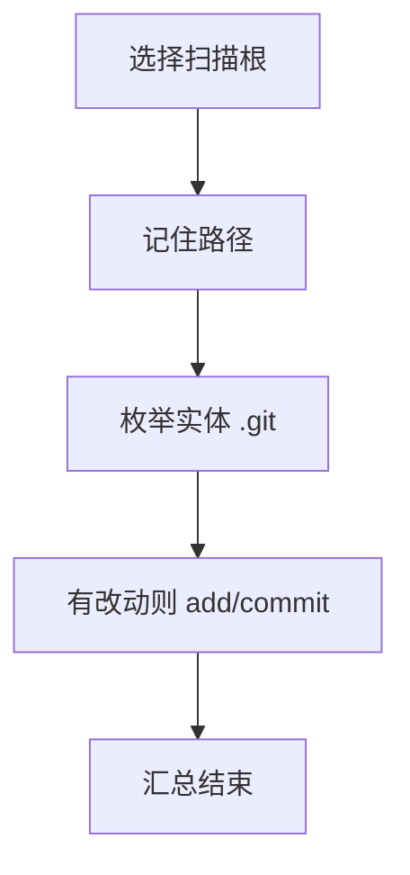

# `【MacOS】♻️批量Git提交（不含推送）.command`


<!-- jobs-toc:start -->
<!-- jobs-toc:source {"v":2,"token":"[toc]"} -->
<details>
<summary>📚 目录（点击展开 / 收起）</summary>

- [🔥 前言](#jobs-toc-heading-1)
- [一、功能覆盖](#jobs-toc-heading-2)
- [二、运行方式](#jobs-toc-heading-3)
- [三、输入、选项与结果](#jobs-toc-heading-4)
- [四、环境与依赖](#jobs-toc-heading-5)
- [五、副作用、限制与日志](#jobs-toc-heading-6)
- [六、操作流程](#jobs-toc-heading-7)

</details>
<!-- jobs-toc:end -->

## <span id="jobs-toc-heading-1" data-jobs-toc="v2">🔥 <font id=前言>前言</font></span><!-- jobs-toc:heading-end -->

- 采用 Shell 脚本的原因：Shell 来自 [**macOS**](https://www.apple.com/macos/) 原生系统底层，虽然写法相对繁琐冗杂，但执行效率高，并且不需要额外介入 [**Ruby**](https://www.ruby-lang.org)、[**Python**](https://www.python.org) 等第三方运行环境，因此具备更好的移植性。
- 本自述文件对应脚本：`【MacOS】♻️批量Git提交（不含推送）.command`。
- 脚本位置：本目录中的同名 `.command`，从当前 README 所在目录运行。
- 脚本定位：遍历指定大目录中的 Git 仓库，有改动时自动暂存和创建本地提交。

## <span id="jobs-toc-heading-2" data-jobs-toc="v2">一、功能覆盖 <a href="#前言" style="font-size:17px; color:green;"><b>🔼</b></a> <a href="#🔚" style="font-size:17px; color:green;"><b>🔽</b></a></span><!-- jobs-toc:heading-end -->

| 范围 | 当前能力 |
| --- | --- |
| 目标 | 遍历指定大目录中的 Git 仓库，有改动时自动暂存和创建本地提交。 |
| 能力 | 输入 / 拖入扫描根目录；当前用户目录的 `.last_sourcetree_path` 保存上次路径，后续回车复用；用 find 搜寻 `.git` 目录并排序去重；实体 `.git` 才被列入，指针形式的子模块 / worktree 不在此扫描范围。 |
| 说明入口 | [同名主脚本](./【MacOS】♻️批量Git提交（不含推送）.command) |

## <span id="jobs-toc-heading-3" data-jobs-toc="v2">二、运行方式 <a href="#前言" style="font-size:17px; color:green;"><b>🔼</b></a> <a href="#🔚" style="font-size:17px; color:green;"><b>🔽</b></a></span><!-- jobs-toc:heading-end -->

推荐双击 `.command` 运行。终端方式如下：

```shell
chmod +x './【MacOS】♻️批量Git提交（不含推送）.command'
'./【MacOS】♻️批量Git提交（不含推送）.command'
```

脚本启动后显示内置说明并等待回车。后续选择与确认以本 README 的实际功能和副作用章节为准。

## <span id="jobs-toc-heading-4" data-jobs-toc="v2">三、输入、选项与结果 <a href="#前言" style="font-size:17px; color:green;"><b>🔼</b></a> <a href="#🔚" style="font-size:17px; color:green;"><b>🔽</b></a></span><!-- jobs-toc:heading-end -->

> **目的：** 遍历指定大目录中的 Git 仓库，有改动时自动暂存和创建本地提交。

- 输入 / 拖入扫描根目录；当前用户目录的 `.last_sourcetree_path` 保存上次路径，后续回车复用。
- 用 find 搜寻 `.git` 目录并排序去重；实体 `.git` 才被列入，指针形式的子模块 / worktree 不在此扫描范围。
- 逐仓检查 `git status --porcelain`；有改动执行 `git add .`。
- 提交说明固定为 `自动提交：<当前日期时间>`；无改动仓库跳过，提交失败显示提示后继续。
- 不执行 push，最终留在扫描循环最后成功进入的仓库。

## <span id="jobs-toc-heading-5" data-jobs-toc="v2">四、环境与依赖 <a href="#前言" style="font-size:17px; color:green;"><b>🔼</b></a> <a href="#🔚" style="font-size:17px; color:green;"><b>🔽</b></a></span><!-- jobs-toc:heading-end -->

需要 Git、find 和可写目标仓；提交要求已配置作者身份。没有 dry-run / push 参数。

## <span id="jobs-toc-heading-6" data-jobs-toc="v2">五、副作用、限制与日志 <a href="#前言" style="font-size:17px; color:green;"><b>🔼</b></a> <a href="#🔚" style="font-size:17px; color:green;"><b>🔽</b></a></span><!-- jobs-toc:heading-end -->

- 会把每个仓库全部可跟踪改动混入同一提交，没有逐仓预览或自定义提交说明菜单。
- find 结果通过 Shell 数组分词，路径含空格可能拆分；没有依赖目录排除，也不保证按子仓先于父仓排序。
- 提交失败的标准错误被重定向，提示“无需提交”不能证明成功；须分别检查各仓状态与日志。
- 日志为系统临时目录中的 `【MacOS】♻️批量Git提交（不含推送）.log`，以脚本结束时打印的实际位置为准。脚本未保证业务命令全部 stdout / stderr 都写入日志。
- 本文按源码静态核对；没有执行真实创建、安装、删除、提交、密钥配置或远端操作。

## <span id="jobs-toc-heading-7" data-jobs-toc="v2">六、操作流程 <a href="#前言" style="font-size:17px; color:green;"><b>🔼</b></a> <a href="#🔚" style="font-size:17px; color:green;"><b>🔽</b></a></span><!-- jobs-toc:heading-end -->



<a id="🔚" href="#前言" style="font-size:17px; color:green; font-weight:bold;">我是有底线的➤点我回到首页</a>
