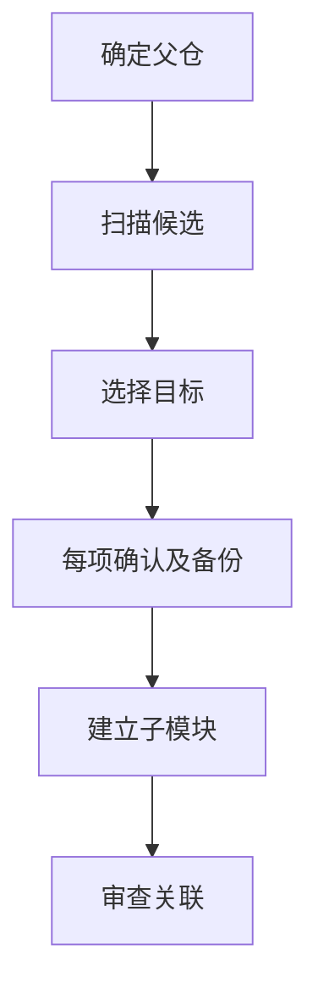

# `【MacOS】♻️检测并转换为子Git.command`


<!-- jobs-toc:start -->
<!-- jobs-toc:source {"v":2,"token":"[toc]"} -->
<details>
<summary>📚 目录（点击展开 / 收起）</summary>

- [🔥 前言](#jobs-toc-heading-1)
- [一、功能覆盖](#jobs-toc-heading-2)
- [二、运行方式](#jobs-toc-heading-3)
- [三、输入、选项与结果](#jobs-toc-heading-4)
- [四、环境与依赖](#jobs-toc-heading-5)
- [五、副作用、限制与日志](#jobs-toc-heading-6)
- [六、操作流程](#jobs-toc-heading-7)

</details>
<!-- jobs-toc:end -->

> **Python 环境预检**：实际调用 [**Python**](https://www.python.org/) 前使用本文件内嵌的环境预检函数，通过 [**Homebrew**](https://brew.sh/) 管理运行时；脚本可单文件复制运行，不需要旁边的支持目录。终端自述确认后执行 `brew update` 更新本体及公式索引；只在指定公式 `python@3.13` 缺失、损坏或版本不满足 `3.11+` 时安装或修复，健康运行时直接复用。缺失 Homebrew 时强提示选安装路径：精确大写 `YES` 选系统标准目录，其它输入或回车选用户目录；失败停止，不自动换路。必需安装或修复直接回车执行，任意非空输入（含空格）取消。预检不执行全局 `brew upgrade`。

## <span id="jobs-toc-heading-1" data-jobs-toc="v2">🔥 <font id=前言>前言</font></span><!-- jobs-toc:heading-end -->

- 脚本入口使用 macOS 原生 Shell；其中的解析、转换或服务功能需要下述已验证的 Python 运行时。
- 本自述文件对应脚本：`【MacOS】♻️检测并转换为子Git.command`。
- 脚本位置：本目录中的同名 `.command`，从当前 README 所在目录运行。
- 脚本定位：扫描父仓中的独立嵌套 Git，交互选择后转成子模块关联。

## <span id="jobs-toc-heading-2" data-jobs-toc="v2">一、功能覆盖 <a href="#前言" style="font-size:17px; color:green;"><b>🔼</b></a> <a href="#🔚" style="font-size:17px; color:green;"><b>🔽</b></a></span><!-- jobs-toc:heading-end -->

| 范围 | 当前能力 |
| --- | --- |
| 目标 | 扫描父仓中的独立嵌套 Git，交互选择后转成子模块关联。 |
| 能力 | 默认以启动时当前目录为起点，也接受第一个路径参数；非 Git 路径循环要求重输，并解析到所属 Git 根；枚举 `.git` 目录或指针文件，排除 `.gitmodules` 已登记 path 及 Pods、build、DerivedData、Carthage、.swiftpm、node_modules、.gradle、.idea、.vscode 等目录。 |
| 说明入口 | [同名主脚本](./【MacOS】♻️检测并转换为子Git.command) |

## <span id="jobs-toc-heading-3" data-jobs-toc="v2">二、运行方式 <a href="#前言" style="font-size:17px; color:green;"><b>🔼</b></a> <a href="#🔚" style="font-size:17px; color:green;"><b>🔽</b></a></span><!-- jobs-toc:heading-end -->

推荐双击 `.command` 运行。终端方式如下：

```shell
chmod +x './【MacOS】♻️检测并转换为子Git.command'
'./【MacOS】♻️检测并转换为子Git.command'
```

脚本启动后显示内置说明并等待回车。后续选择与确认以本 README 的实际功能和副作用章节为准。

## <span id="jobs-toc-heading-4" data-jobs-toc="v2">三、输入、选项与结果 <a href="#前言" style="font-size:17px; color:green;"><b>🔼</b></a> <a href="#🔚" style="font-size:17px; color:green;"><b>🔽</b></a></span><!-- jobs-toc:heading-end -->

> **目的：** 扫描父仓中的独立嵌套 Git，交互选择后转成子模块关联。

- 默认以启动时当前目录为起点，也接受第一个路径参数；非 Git 路径循环要求重输，并解析到所属 Git 根。
- 枚举 `.git` 目录或指针文件，排除 `.gitmodules` 已登记 path 及 Pods、build、DerivedData、Carthage、.swiftpm、node_modules、.gradle、.idea、.vscode 等目录。
- 展示相对路径、origin、分支；单项直接确认，多项用 fzf 的 TAB 多选、ALL 或 Ctrl+A 全选。
- 父仓有改动时显示状态，回车继续、非空返回；每项再次采用回车转换、非空跳过。
- 转换前把原工作树移到系统临时目录备份，清理对应旧索引 / 关联残留，再用原 origin 执行 submodule add。

## <span id="jobs-toc-heading-5" data-jobs-toc="v2">四、环境与依赖 <a href="#前言" style="font-size:17px; color:green;"><b>🔼</b></a> <a href="#🔚" style="font-size:17px; color:green;"><b>🔽</b></a></span><!-- jobs-toc:heading-end -->

需要 Git、交互 TTY、Homebrew、fzf；缺依赖可安装，已有 Homebrew / fzf 的维护选择回车跳过，非空执行。路径解析存在 Python / Perl 回退。

## <span id="jobs-toc-heading-6" data-jobs-toc="v2">五、副作用、限制与日志 <a href="#前言" style="font-size:17px; color:green;"><b>🔼</b></a> <a href="#🔚" style="font-size:17px; color:green;"><b>🔽</b></a></span><!-- jobs-toc:heading-end -->

- 会移动子仓工作树、写父仓 `.gitmodules`、索引 gitlink 和本地关联；备份位置以终端实际输出为准，不能承诺零副作用。
- 需要可读取的子仓 origin；下载依赖网络。转换结果留待人工核查，不自动提交或推送。
- 会清理对应 `.git/modules` 残留；先确认原子仓未推送提交、未提交内容和临时备份均可恢复。
- 日志为系统临时目录中的 `【MacOS】♻️检测并转换为子Git.log`，以脚本结束时打印的实际位置为准。脚本未保证业务命令全部 stdout / stderr 都写入日志。
- 本文按源码静态核对；没有执行真实创建、安装、删除、提交、密钥配置或远端操作。

## <span id="jobs-toc-heading-7" data-jobs-toc="v2">六、操作流程 <a href="#前言" style="font-size:17px; color:green;"><b>🔼</b></a> <a href="#🔚" style="font-size:17px; color:green;"><b>🔽</b></a></span><!-- jobs-toc:heading-end -->



<a id="🔚" href="#前言" style="font-size:17px; color:green; font-weight:bold;">我是有底线的➤点我回到首页</a>
