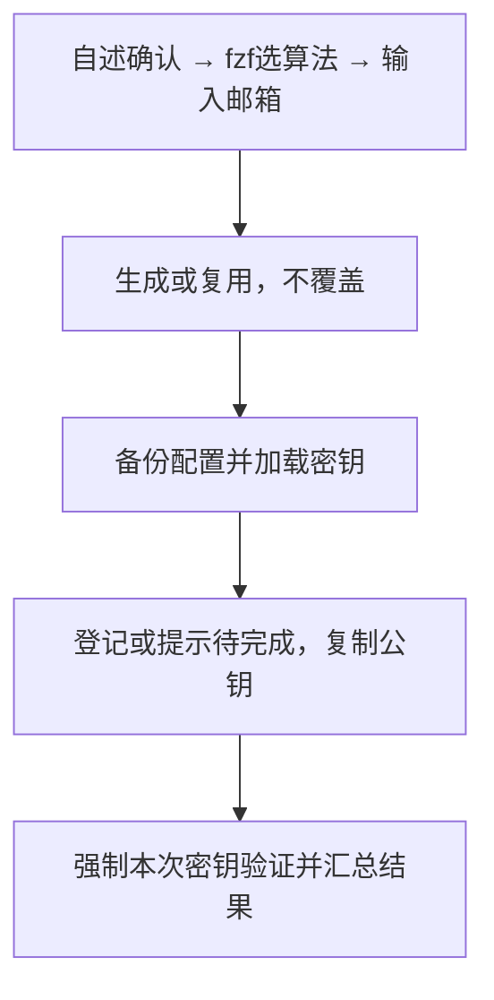

# `【MacOS】⚙️双击为私人账户生成 SSH 密钥.command`


<!-- jobs-toc:start -->
<!-- jobs-toc:source {"v":2,"token":"[toc]"} -->
<details>
<summary>📚 目录（点击展开 / 收起）</summary>

- [🔥 前言](#jobs-toc-heading-1)
- [一、功能覆盖](#jobs-toc-heading-2)
- [二、运行方式](#jobs-toc-heading-3)
- [三、输入、选项与结果](#jobs-toc-heading-4)
- [四、环境与依赖](#jobs-toc-heading-5)
- [五、副作用、限制与日志](#jobs-toc-heading-6)
- [六、操作流程](#jobs-toc-heading-7)

</details>
<!-- jobs-toc:end -->

## <span id="jobs-toc-heading-1" data-jobs-toc="v2">🔥 <font id=前言>前言</font></span><!-- jobs-toc:heading-end -->

- 采用 Shell 脚本的原因：Shell 来自 [**macOS**](https://www.apple.com/macos/) 原生系统底层，虽然写法相对繁琐冗杂，但执行效率高，并且不需要额外介入 [**Ruby**](https://www.ruby-lang.org)、[**Python**](https://www.python.org) 等第三方运行环境，因此具备更好的移植性。
- 本自述文件对应脚本：`【MacOS】⚙️双击为私人账户生成 SSH 密钥.command`。
- 脚本位置：本目录中的同名 `.command`，从当前 README 所在目录运行。
- 脚本定位：生成个人 SSH 密钥，加载 ssh-agent、复制公钥并打开 GitHub 配置页面。

## <span id="jobs-toc-heading-2" data-jobs-toc="v2">一、功能覆盖 <a href="#前言" style="font-size:17px; color:green;"><b>🔼</b></a> <a href="#🔚" style="font-size:17px; color:green;"><b>🔽</b></a></span><!-- jobs-toc:heading-end -->

| 范围 | 当前能力 |
| --- | --- |
| 目标 | 生成个人 SSH 密钥，加载 ssh-agent、复制公钥并打开 GitHub 配置页面。 |
| 能力 | fzf 选择 ED25519 / RSA 4096；邮箱默认 `295060456@qq.com`，可输入替换；自动生成或复用个人密钥、配置实际 IdentityFile、加载 agent、复制公钥并验证 GitHub。 |
| 目录说明 | 生成或复用密钥后，在当前用户 `.ssh/README.md` 未被占用时新建中文用途说明；已有任何同名文件、有效 / 悬空链接或目录均保留，不覆盖、不追加、不更新。 |
| Sourcetree 识别 | 严格 SSH 认证通过后，以实际认证用户名建立同目录 `<用户名>-GitHub` 与 `.pub` 相对符号链接；原始 `id_..._personal` 文件不改名，冲突不覆盖。 |
| 说明入口 | [同名主脚本](<./【MacOS】⚙️双击为私人账户生成 SSH 密钥.command>) |

密钥目录及打开位置使用当前用户的 HOME 解析，不按登录名拼接固定用户目录，兼容迁移后的用户主目录。

## <span id="jobs-toc-heading-3" data-jobs-toc="v2">二、运行方式 <a href="#前言" style="font-size:17px; color:green;"><b>🔼</b></a> <a href="#🔚" style="font-size:17px; color:green;"><b>🔽</b></a></span><!-- jobs-toc:heading-end -->

推荐双击 `.command` 运行。终端方式如下：

```shell
chmod +x './【MacOS】⚙️双击为私人账户生成 SSH 密钥.command'
'./【MacOS】⚙️双击为私人账户生成 SSH 密钥.command'
```

脚本启动后显示内置说明并等待回车。后续选择与确认以本 README 的实际功能和副作用章节为准。

## <span id="jobs-toc-heading-4" data-jobs-toc="v2">三、输入、选项与结果 <a href="#前言" style="font-size:17px; color:green;"><b>🔼</b></a> <a href="#🔚" style="font-size:17px; color:green;"><b>🔽</b></a></span><!-- jobs-toc:heading-end -->

> **目的：** 生成个人 SSH 密钥，加载 ssh-agent、复制公钥并打开 GitHub 配置页面。

- 使用 [**fzf**](https://github.com/junegunn/fzf) 选择 ED25519（默认高亮）或 RSA 4096；方向键或 Tab 移动、回车确认，取消行 / Esc / 空选 / 选择器失败均不生成密钥。菜单还可打开 GitHub 公钥网页、本机密钥文件夹或 [Token 网页](https://github.com/settings/tokens)，操作后返回算法选择。
- 算法区别：ED25519 密钥更短、签名通常更快，推荐现代环境使用；RSA 4096 主要兼容不支持 ED25519 的旧系统，位数更大不等于安全性一定更高。[GitHub 官方算法说明](https://docs.github.com/en/authentication/connecting-to-github-with-ssh/generating-a-new-ssh-key-and-adding-it-to-the-ssh-agent)。
- 邮箱是唯一必需文字输入；默认 `295060456@qq.com`，可回车使用或输入替换。算法和邮箱确定后直接执行，不再重复确认。
- 新密钥使用空口令，默认文件名为 `id_ed25519_personal` / `id_rsa_personal`；同算法、同邮箱且公私钥验证匹配时复用，文件已占用则追加邮箱摘要及序号，不覆盖已有密钥。优先复用当前 ssh-agent，无法连接时启动当前会话 agent，再加载本次私钥，不向 Shell 配置反复追加启动行。
- 在配置 SSH 前尝试新建密钥目录 `README.md`，说明 `config`、个人私钥、`.pub` 公钥与 `known_hosts` 的用途、公私钥区别、安全保管及登记后的测试步骤；同时标明本轮实际文件名，解释 RSA 4096 与冲突后缀命名。正文内嵌于脚本，不依赖工程中的 README，也不读取私钥正文或写入 Token / 密码。使用独占创建保护并发，任意同名项先到先保留；说明写入失败仅警告，继续原有 SSH 配置流程，单独测试连接不会创建说明。
- 复制 `.pub` 公钥。[**GitHub CLI**](https://cli.github.com/) 已登录，输入邮箱属于该账号已验证邮箱且有公钥权限时自动登记，已登记的不重复上传；否则明确显示待完成并打开 GitHub 官方公钥页面。邮箱不是 GitHub 授权凭据，认证失效时仍需在官方页面处理。
- `gh` 状态单独判定：未检测到工具、尚未登录、当前凭据被拒绝（HTTP 401）、请求被拒绝（HTTP 403）、网络 / 证书失败、检测超时与未知检测失败分别提示。仅检查 `github.com` 活跃账号；JSON 命令退出 0 也会检查账户实际状态，非活跃账号的失败不会阻止当前有效账号。旧版本不支持结构化状态或返回无法解析时提示“无法确认登录状态”，不会误报未安装或授权失效。状态检测子进程临时移除 `GH_HOST`，用显式 `--hostname github.com` 定位，避免无登录被合成为空账号 401；其它请求仍固定 GitHub 主机，父进程环境不改。
- 备份并更新 `.ssh/config` 的 Jobs 托管块，`github.com` / `github-personal` 指向实际生成或复用的私钥，保留其它 Host、全局选项和旧 IdentityFile。重复执行不重复备份；异常托管标记、符号链接密钥目录 / 配置或非目录的 `.ssh` 停止处理，不跟随链接改写其它位置。
- 首次缺 GitHub 主机记录时，从官方 HTTPS `https://api.github.com/meta` 验证并补齐 known_hosts；已有记录保持原样。连接测试强制本次私钥，禁用其它 agent 身份与密码询问，严格检查主机指纹；识别 GitHub 认证成功文字及其约定的退出码 1。
- SSH 必须返回退出码 1 和包含实际用户名的完整 GitHub 成功行，才为该账号补齐 Sourcetree 密钥别名；不从邮箱、输入用户名或缓存 gh 身份猜名字。别名为同目录相对符号链接，不复制私钥正文；创建前联合检查两源文件与两个目标，已有正确链接幂等，任意冲突保留，不修改默认 `id_rsa` 等其它密钥。原子创建使用系统 JXA / Foundation 精确指定目标，即使竞争者先放入同名目录也不向目录内部写入；创建失败只警告，不把已成功的 SSH 认证改成失败。
- 手动在网页添加公钥后，以原邮箱与原算法重新运行终端脚本即可优先复用原密钥、重新认证并补齐链接，无须删除或重新生成。Sourcetree 账户用户名须与认证返回的实际 GitHub 用户名一致；脚本不修改 Sourcetree 账户资料或 Token。

## <span id="jobs-toc-heading-5" data-jobs-toc="v2">四、环境与依赖 <a href="#前言" style="font-size:17px; color:green;"><b>🔼</b></a> <a href="#🔚" style="font-size:17px; color:green;"><b>🔽</b></a></span><!-- jobs-toc:heading-end -->

需要 MacOS 原生 zsh、OpenSSH、ssh-agent、ssh-add、curl、plutil、pbcopy、open 与可用 fzf；不依赖 readlink / realpath。默认邮箱按用户指定提供，gh 可提供自动登记。fzf 缺失或损坏时停止，提示 `brew install fzf` / `brew reinstall fzf`，不会自动安装、升级或回退数字输入。网络用于官方主机公钥、GitHub 登记与 SSH 认证。每次 gh 调用默认限时 20 秒，可通过 `JOBS_SSH_GH_TIMEOUT_SECONDS` 设置 1～999 秒；超时停止该调用并显示待完成，不阻塞终端。

## <span id="jobs-toc-heading-6" data-jobs-toc="v2">五、副作用、限制与日志 <a href="#前言" style="font-size:17px; color:green;"><b>🔼</b></a> <a href="#🔚" style="font-size:17px; color:green;"><b>🔽</b></a></span><!-- jobs-toc:heading-end -->

- 终端先显示用途、作用范围和空口令说明，回车继续、其它输入取消；没有 TTY 或输入结束时停止。只确认一次，算法和邮箱收集成功后自动执行全部步骤。
- [**Sourcetree**](https://www.sourcetreeapp.com/) 使用本机 OpenSSH 配置。账户页警告图标不单独作为认证结果；以本次私钥的真实认证输出为准，不复制或覆盖其它私钥来消除图标。脚本不自动改未公开稳定的 Sourcetree GUI 设置。
- 会写入 SSH 配置、密钥和必要的 known_hosts，仅在未占用时新建 `.ssh/README.md`，认证通过后建立本次密钥的 Sourcetree 相对链接，改写剪贴板；在绑定邮箱与 gh 已授权身份匹配时自动登记公钥。不改全局 Git 配置或仓库远端地址，不修改其它账户私钥；空口令密钥须自行妥善保护。
- 日志为系统临时目录中的 `【MacOS】⚙️双击为私人账户生成 SSH 密钥.log`，以脚本结束时打印的实际位置为准。脚本未保证业务命令全部 stdout / stderr 都写入日志。
- 已做 zsh 静态与临时目录隔离验证，覆盖配置保留及幂等、密钥冲突避让与复用、账号邮箱验证、官方主机公钥解析和本次身份认证判断；gh 分类覆盖缺工具、未登录、401 / 403、网络、两类超时、无效响应、活跃账号选择和不误上传，原始授权响应与令牌不写入日志。未执行真实创建密钥、用户配置写入、远端登记、安装、提交或推送。
- 目录说明另经临时目录验证：首次生成、RSA 后缀文件名、已有文件字节与修改时间不变、有效 / 悬空 / 目录链接和同名目录保留、创建失败继续，以及 12 个并发创建者通过共同检查后仅一个成功写入完整说明。没有借此修改真实用户的 `.ssh/README.md`。
- Sourcetree 补齐流程在临时空主目录与 SSH 替身中验证：首次未登记失败不创建别名，登记后复用原密钥并按真实账号创建相对链接，重复执行幂等；原密钥、公钥、config、known_hosts 和 README 的字节及修改时间保持不变。另验错误账号、非法用户名、退出码错误、整对冲突、悬空链接、目录冲突与源链接保护；JXA 相对链接创建使用真实系统 API。没有改动真实账户资料或运行 Sourcetree UI 验收。

## <span id="jobs-toc-heading-7" data-jobs-toc="v2">六、操作流程 <a href="#前言" style="font-size:17px; color:green;"><b>🔼</b></a> <a href="#🔚" style="font-size:17px; color:green;"><b>🔽</b></a></span><!-- jobs-toc:heading-end -->



<a id="🔚" href="#前言" style="font-size:17px; color:green; font-weight:bold;">我是有底线的➤点我回到首页</a>
