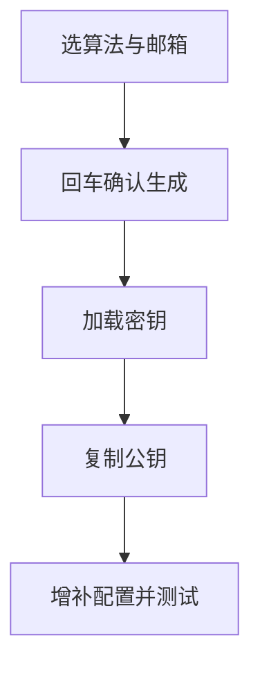

# `【MacOS】⚙️双击为私人账户生成 SSH 密钥（加密手段：RSA 4096 + ED25519 二选一）.command`


<!-- jobs-toc:start -->
<!-- jobs-toc:source {"v":2,"token":"[toc]"} -->
<details>
<summary>📚 目录（点击展开 / 收起）</summary>

- [🔥 前言](#jobs-toc-heading-1)
- [一、功能覆盖](#jobs-toc-heading-2)
- [二、运行方式](#jobs-toc-heading-3)
- [三、输入、选项与结果](#jobs-toc-heading-4)
- [四、环境与依赖](#jobs-toc-heading-5)
- [五、副作用、限制与日志](#jobs-toc-heading-6)
- [六、操作流程](#jobs-toc-heading-7)

</details>
<!-- jobs-toc:end -->

## <span id="jobs-toc-heading-1" data-jobs-toc="v2">🔥 <font id=前言>前言</font></span><!-- jobs-toc:heading-end -->

- 采用 Shell 脚本的原因：Shell 来自 [**macOS**](https://www.apple.com/macos/) 原生系统底层，虽然写法相对繁琐冗杂，但执行效率高，并且不需要额外介入 [**Ruby**](https://www.ruby-lang.org)、[**Python**](https://www.python.org) 等第三方运行环境，因此具备更好的移植性。
- 本自述文件对应脚本：`【MacOS】⚙️双击为私人账户生成 SSH 密钥（加密手段：RSA 4096 + ED25519 二选一）.command`。
- 脚本位置：本目录中的同名 `.command`，从当前 README 所在目录运行。
- 脚本定位：生成个人 SSH 密钥，加载 ssh-agent、复制公钥并打开 GitHub 配置页面。

## <span id="jobs-toc-heading-2" data-jobs-toc="v2">一、功能覆盖 <a href="#前言" style="font-size:17px; color:green;"><b>🔼</b></a> <a href="#🔚" style="font-size:17px; color:green;"><b>🔽</b></a></span><!-- jobs-toc:heading-end -->

| 范围 | 当前能力 |
| --- | --- |
| 目标 | 生成个人 SSH 密钥，加载 ssh-agent、复制公钥并打开 GitHub 配置页面。 |
| 能力 | 选择算法：回车或 `1` 为 ED25519，`2` 为 RSA 4096；非法输入回落 ED25519；个人邮箱可输入或使用屏幕提示的默认值；生成目标固定为当前用户 `.ssh` 中的 `id_rsa_personal`，与所选算法无关。 |
| 说明入口 | [同名主脚本](<./【MacOS】⚙️双击为私人账户生成 SSH 密钥（加密手段：RSA 4096 + ED25519 二选一）.command>) |

密钥目录及打开位置使用当前用户的 HOME 解析，不按登录名拼接固定用户目录，兼容迁移后的用户主目录。

## <span id="jobs-toc-heading-3" data-jobs-toc="v2">二、运行方式 <a href="#前言" style="font-size:17px; color:green;"><b>🔼</b></a> <a href="#🔚" style="font-size:17px; color:green;"><b>🔽</b></a></span><!-- jobs-toc:heading-end -->

推荐双击 `.command` 运行。终端方式如下：

```shell
chmod +x './【MacOS】⚙️双击为私人账户生成 SSH 密钥（加密手段：RSA 4096 + ED25519 二选一）.command'
'./【MacOS】⚙️双击为私人账户生成 SSH 密钥（加密手段：RSA 4096 + ED25519 二选一）.command'
```

脚本启动后显示内置说明并等待回车。后续选择与确认以本 README 的实际功能和副作用章节为准。

## <span id="jobs-toc-heading-4" data-jobs-toc="v2">三、输入、选项与结果 <a href="#前言" style="font-size:17px; color:green;"><b>🔼</b></a> <a href="#🔚" style="font-size:17px; color:green;"><b>🔽</b></a></span><!-- jobs-toc:heading-end -->

> **目的：** 生成个人 SSH 密钥，加载 ssh-agent、复制公钥并打开 GitHub 配置页面。

- 选择算法：回车或 `1` 为 ED25519，`2` 为 RSA 4096；非法输入回落 ED25519。
- 个人邮箱可输入或使用屏幕提示的默认值；生成目标固定为当前用户 `.ssh` 中的 `id_rsa_personal`，与所选算法无关。
- 生成密钥使用空口令；启动 ssh-agent，调用 `ssh-add --apple-use-keychain` 并列出已加载密钥。
- 显示并复制 `.pub` 公钥，打开 GitHub SSH 设置页供手工登记。
- 缺少 `Host github.com` 时向 `.ssh/config` 追加配置；向已有 `.zshrc`、`.bash_profile` 追加 ssh-agent 启动行，最后交互测试 `ssh -T git@github.com`。

## <span id="jobs-toc-heading-5" data-jobs-toc="v2">四、环境与依赖 <a href="#前言" style="font-size:17px; color:green;"><b>🔼</b></a> <a href="#🔚" style="font-size:17px; color:green;"><b>🔽</b></a></span><!-- jobs-toc:heading-end -->

需要 macOS OpenSSH、ssh-agent、ssh-add、pbcopy、open；依赖读取路径的 readlink / realpath。网络用于设置页与 SSH 连通性测试。

## <span id="jobs-toc-heading-6" data-jobs-toc="v2">五、副作用、限制与日志 <a href="#前言" style="font-size:17px; color:green;"><b>🔼</b></a> <a href="#🔚" style="font-size:17px; color:green;"><b>🔽</b></a></span><!-- jobs-toc:heading-end -->

- 生成和检查确认采用“回车同意，非空输入退出”；不能把本入口写成统一 YES 确认。已有同名密钥由 ssh-keygen 自己询问覆盖。
- 生成文件名是 `id_rsa_personal`，但追加的 Host 配置指向 `id_ed25519`；须人工核对 IdentityFile，不能认为生成后已完成连接配置。
- 会写入长期 SSH / Shell 配置并改写剪贴板；不自动上传公钥，不自动切换远端地址。空口令密钥须自行妥善保护。
- 日志为系统临时目录中的 `【MacOS】⚙️双击为私人账户生成 SSH 密钥（加密手段：RSA 4096 + ED25519 二选一）.log`，以脚本结束时打印的实际位置为准。脚本未保证业务命令全部 stdout / stderr 都写入日志。
- 本文按源码静态核对；没有执行真实创建、安装、删除、提交、密钥配置或远端操作。

## <span id="jobs-toc-heading-7" data-jobs-toc="v2">六、操作流程 <a href="#前言" style="font-size:17px; color:green;"><b>🔼</b></a> <a href="#🔚" style="font-size:17px; color:green;"><b>🔽</b></a></span><!-- jobs-toc:heading-end -->



<a id="🔚" href="#前言" style="font-size:17px; color:green; font-weight:bold;">我是有底线的➤点我回到首页</a>
