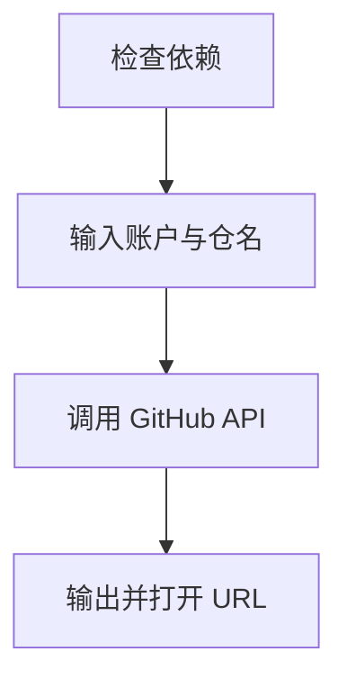

# `【MacOS】⚙️双击生成Github远程仓库URL.command`


<!-- jobs-toc:start -->
<!-- jobs-toc:source {"v":2,"token":"[toc]"} -->
<details>
<summary>📚 目录（点击展开 / 收起）</summary>

- [🔥 前言](#jobs-toc-heading-1)
- [一、功能覆盖](#jobs-toc-heading-2)
- [二、运行方式](#jobs-toc-heading-3)
- [三、输入、选项与结果](#jobs-toc-heading-4)
- [四、环境与依赖](#jobs-toc-heading-5)
- [五、副作用、限制与日志](#jobs-toc-heading-6)
- [六、操作流程](#jobs-toc-heading-7)

</details>
<!-- jobs-toc:end -->

## <span id="jobs-toc-heading-1" data-jobs-toc="v2">🔥 <font id=前言>前言</font></span><!-- jobs-toc:heading-end -->

- 采用 Shell 脚本的原因：Shell 来自 [**macOS**](https://www.apple.com/macos/) 原生系统底层，虽然写法相对繁琐冗杂，但执行效率高，并且不需要额外介入 [**Ruby**](https://www.ruby-lang.org)、[**Python**](https://www.python.org) 等第三方运行环境，因此具备更好的移植性。
- 本自述文件对应脚本：`【MacOS】⚙️双击生成Github远程仓库URL.command`。
- 脚本位置：本目录中的同名 `.command`，从当前 README 所在目录运行。
- 脚本定位：在 GitHub 创建远端仓库，并输出、打开 API 返回的网页地址。

## <span id="jobs-toc-heading-2" data-jobs-toc="v2">一、功能覆盖 <a href="#前言" style="font-size:17px; color:green;"><b>🔼</b></a> <a href="#🔚" style="font-size:17px; color:green;"><b>🔽</b></a></span><!-- jobs-toc:heading-end -->

| 范围 | 当前能力 |
| --- | --- |
| 目标 | 在 GitHub 创建远端仓库，并输出、打开 API 返回的网页地址。 |
| 能力 | 检查 Homebrew 与 jq；jq 缺失时执行 `brew install jq`；交互输入 GitHub 用户名、个人访问令牌和仓库名；用户名仅收集，API 根据令牌确定账户。 |
| 说明入口 | [同名主脚本](./【MacOS】⚙️双击生成Github远程仓库URL.command) |

## <span id="jobs-toc-heading-3" data-jobs-toc="v2">二、运行方式 <a href="#前言" style="font-size:17px; color:green;"><b>🔼</b></a> <a href="#🔚" style="font-size:17px; color:green;"><b>🔽</b></a></span><!-- jobs-toc:heading-end -->

推荐双击 `.command` 运行。终端方式如下：

```shell
chmod +x './【MacOS】⚙️双击生成Github远程仓库URL.command'
'./【MacOS】⚙️双击生成Github远程仓库URL.command'
```

脚本启动后显示内置说明并等待回车。后续选择与确认以本 README 的实际功能和副作用章节为准。

## <span id="jobs-toc-heading-4" data-jobs-toc="v2">三、输入、选项与结果 <a href="#前言" style="font-size:17px; color:green;"><b>🔼</b></a> <a href="#🔚" style="font-size:17px; color:green;"><b>🔽</b></a></span><!-- jobs-toc:heading-end -->

> **目的：** 在 GitHub 创建远端仓库，并输出、打开 API 返回的网页地址。

- 检查 Homebrew 与 jq；jq 缺失时执行 `brew install jq`。
- 交互输入 GitHub 用户名、个人访问令牌和仓库名；用户名仅收集，API 根据令牌确定账户。
- 向 `https://api.github.com/user/repos` 发送 POST，只提交 `name` 字段；未提供 private/public 菜单。
- 用 jq 读取 `html_url`，在终端输出，并优先调用 `xdg-open`、否则 macOS `open`。

## <span id="jobs-toc-heading-5" data-jobs-toc="v2">四、环境与依赖 <a href="#前言" style="font-size:17px; color:green;"><b>🔼</b></a> <a href="#🔚" style="font-size:17px; color:green;"><b>🔽</b></a></span><!-- jobs-toc:heading-end -->

需要网络、curl、Homebrew 和 jq。令牌权限须允许创建目标账户仓库；没有专门的 dry-run 参数。

## <span id="jobs-toc-heading-6" data-jobs-toc="v2">五、副作用、限制与日志 <a href="#前言" style="font-size:17px; color:green;"><b>🔼</b></a> <a href="#🔚" style="font-size:17px; color:green;"><b>🔽</b></a></span><!-- jobs-toc:heading-end -->

- 令牌由普通 `read` 读取，会在终端回显；不能在共享终端运行，也不要把令牌复制到日志或截图。
- 源码没有 HTTP 状态和 API 错误分支校验；输出 success 或 `null` 不代表远端一定创建成功，应核对网页与 API 错误。
- 该脚本会在账户创建真实仓库；不初始化本地仓库、不添加 origin、不提交或推送。
- 日志为系统临时目录中的 `【MacOS】⚙️双击生成Github远程仓库URL.log`，以脚本结束时打印的实际位置为准。脚本未保证业务命令全部 stdout / stderr 都写入日志。
- 本文按源码静态核对；没有执行真实创建、安装、删除、提交、密钥配置或远端操作。

## <span id="jobs-toc-heading-7" data-jobs-toc="v2">六、操作流程 <a href="#前言" style="font-size:17px; color:green;"><b>🔼</b></a> <a href="#🔚" style="font-size:17px; color:green;"><b>🔽</b></a></span><!-- jobs-toc:heading-end -->



<a id="🔚" href="#前言" style="font-size:17px; color:green; font-weight:bold;">我是有底线的➤点我回到首页</a>
