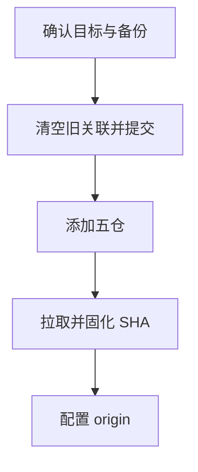

# `【MacOS】⬆️Git添加子模块.command`


<!-- jobs-toc:start -->
<!-- jobs-toc:source {"v":2,"token":"[toc]"} -->
<details>
<summary>📚 目录（点击展开 / 收起）</summary>

- [🔥 前言](#jobs-toc-heading-1)
- [一、功能覆盖](#jobs-toc-heading-2)
- [二、运行方式](#jobs-toc-heading-3)
- [三、输入、选项与结果](#jobs-toc-heading-4)
- [四、环境与依赖](#jobs-toc-heading-5)
- [五、副作用、限制与日志](#jobs-toc-heading-6)
- [六、操作流程](#jobs-toc-heading-7)

</details>
<!-- jobs-toc:end -->

## <span id="jobs-toc-heading-1" data-jobs-toc="v2">🔥 <font id=前言>前言</font></span><!-- jobs-toc:heading-end -->

- 采用 Shell 脚本的原因：Shell 来自 [**macOS**](https://www.apple.com/macos/) 原生系统底层，虽然写法相对繁琐冗杂，但执行效率高，并且不需要额外介入 [**Ruby**](https://www.ruby-lang.org)、[**Python**](https://www.python.org) 等第三方运行环境，因此具备更好的移植性。
- 本自述文件对应脚本：`【MacOS】⬆️Git添加子模块.command`。
- 脚本位置：本目录中的同名 `.command`，从当前 README 所在目录运行。
- 脚本定位：按内置五仓清单全量重建子模块，并把关联与最新指针提交到父仓。

<strong id="submodule-quick-look">先看例子：新增子仓跟随父仓平台</strong>

内置清单使用 `../JobsCommand-Flutter.git`，按自己的目录映射生成如下记录：

```ini
[submodule "JobsGenesis@JobsCommand.Flutter"]
    path = JobsGenesis@JobsCommand.Flutter
    url = ../JobsCommand-Flutter.git
    branch = main
```

| 父仓地址示例 | 子仓解析地址 |
| --- | --- |
| `https://github.com/JobsKits/JobsGenesis.git` | `https://github.com/JobsKits/JobsCommand-Flutter.git` |
| `https://gitee.com/JobsGo/JobsGenesis.git` | `https://gitee.com/JobsGo/JobsCommand-Flutter.git` |
| `ssh://git@git.example.com:2222/team/JobsGenesis.git` | `ssh://git@git.example.com:2222/team/JobsCommand-Flutter.git` |

`path` 是本地目录，`url` 是真实远端仓名；[**GitHub**](https://github.com)、[**Gitee**](https://gitee.com)、[**GitLab**](https://gitlab.com) 或自建服务都按父仓地址解析。自建服务行仅说明地址结构，不代表已部署；目标平台须已有对应子仓和所需提交，添加分支默认 `main`，可通过 `SUBMODULE_BRANCH` 指定。

**此入口包含全量重建和自动本地提交流程，没有 push 调用。** 已有父子仓的日常增量关联使用 [更新 gitmodules](../【MacOS】🧾更新gitmodules.command/README.md)。总仓当前使用的 `JobsCommand@Flutter` 目录与上述旧入口的目录名不同，完整对照见 [JobsGenesis README](../../../README.md#submodule-quick-look)。

## <span id="jobs-toc-heading-2" data-jobs-toc="v2">一、功能覆盖 <a href="#前言" style="font-size:17px; color:green;"><b>🔼</b></a> <a href="#🔚" style="font-size:17px; color:green;"><b>🔽</b></a></span><!-- jobs-toc:heading-end -->

| 范围 | 当前能力 |
| --- | --- |
| 目标 | 按内置五仓清单全量重建子模块，并把关联与最新指针提交到父仓。 |
| 能力 | 定位脚本所属 Git 根，执行 git init / add，并枚举 `.gitmodules` 与索引中的全部子模块路径；直接删除现有子模块工作树及对应 `.git/modules`，清空 `.gitmodules`，尝试创建清理提交。 |
| 说明入口 | [同名主脚本](./【MacOS】⬆️Git添加子模块.command) |

## <span id="jobs-toc-heading-3" data-jobs-toc="v2">二、运行方式 <a href="#前言" style="font-size:17px; color:green;"><b>🔼</b></a> <a href="#🔚" style="font-size:17px; color:green;"><b>🔽</b></a></span><!-- jobs-toc:heading-end -->

推荐双击 `.command` 运行。终端方式如下：

```shell
chmod +x './【MacOS】⬆️Git添加子模块.command'
'./【MacOS】⬆️Git添加子模块.command'
```

脚本启动后显示内置说明并等待回车。后续选择与确认以本 README 的实际功能和副作用章节为准。

## <span id="jobs-toc-heading-4" data-jobs-toc="v2">三、输入、选项与结果 <a href="#前言" style="font-size:17px; color:green;"><b>🔼</b></a> <a href="#🔚" style="font-size:17px; color:green;"><b>🔽</b></a></span><!-- jobs-toc:heading-end -->

> **目的：** 按内置五仓清单全量重建子模块，并把关联与最新指针提交到父仓。

- 定位脚本所属 Git 根，执行 git init / add，并枚举 `.gitmodules` 与索引中的全部子模块路径。
- 直接删除现有子模块工作树及对应 `.git/modules`，清空 `.gitmodules`，尝试创建清理提交。
- 内置重新添加 Flutter、iOS、Gits、Others、JobsSh 五仓，使用 `../真实仓名.git`；分支默认 main，环境变量 `SUBMODULE_BRANCH` 可覆盖添加分支。
- 同步登记、递归初始化、拉取远端并 merge；随后尽可能切到 main / origin/main，再把 gitlink 变更提交回父仓。
- 父仓已有 origin 时保留；缺少时要求输入可访问远端并配置。源码没有 git push 调用。

## <span id="jobs-toc-heading-5" data-jobs-toc="v2">四、环境与依赖 <a href="#前言" style="font-size:17px; color:green;"><b>🔼</b></a> <a href="#🔚" style="font-size:17px; color:green;"><b>🔽</b></a></span><!-- jobs-toc:heading-end -->

需要 Git、可访问的五个子仓远端、可用 Git 身份与可写父仓；脚本没有预览模式。

## <span id="jobs-toc-heading-6" data-jobs-toc="v2">五、副作用、限制与日志 <a href="#前言" style="font-size:17px; color:green;"><b>🔼</b></a> <a href="#🔚" style="font-size:17px; color:green;"><b>🔽</b></a></span><!-- jobs-toc:heading-end -->

- **这是破坏性全量重建。** 首屏与业务自述回车后即可删除，不存在额外 YES 门禁；没有原工作树备份。
- 会自动暂存父仓已有改动并尝试创建多笔本地提交；不能用于仅增补关联，也不能承诺保留旧子仓未推送历史。
- `SUBMODULE_BRANCH` 控制添加分支，后续规范化仍尝试 main；需要其它分支时先审查实现，不能只看环境变量。
- 内置本地目录使用 `JobsGenesis@JobsCommand.*` 形式，与当前 JobsGenesis 的 JobsCommand@* 布局不同。已有仓日常登记应使用同级更新 gitmodules 入口。
- 日志为系统临时目录中的 `【MacOS】⬆️Git添加子模块.log`，以脚本结束时打印的实际位置为准。脚本未保证业务命令全部 stdout / stderr 都写入日志。
- 本文按源码静态核对；没有执行真实创建、安装、删除、提交、密钥配置或远端操作。

## <span id="jobs-toc-heading-7" data-jobs-toc="v2">六、操作流程 <a href="#前言" style="font-size:17px; color:green;"><b>🔼</b></a> <a href="#🔚" style="font-size:17px; color:green;"><b>🔽</b></a></span><!-- jobs-toc:heading-end -->



<a id="🔚" href="#前言" style="font-size:17px; color:green; font-weight:bold;">我是有底线的➤点我回到首页</a>
