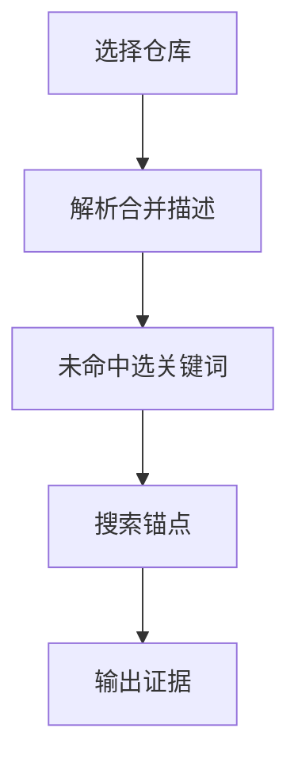

# `【MacOS】🔍Git依据提交日志关键字查找.command`


<!-- jobs-toc:start -->
<!-- jobs-toc:source {"v":2,"token":"[toc]"} -->
<details>
<summary>📚 目录（点击展开 / 收起）</summary>

- [🔥 前言](#jobs-toc-heading-1)
- [一、功能覆盖](#jobs-toc-heading-2)
- [二、运行方式](#jobs-toc-heading-3)
- [三、输入、选项与结果](#jobs-toc-heading-4)
- [四、环境与依赖](#jobs-toc-heading-5)
- [五、副作用、限制与日志](#jobs-toc-heading-6)
- [六、操作流程](#jobs-toc-heading-7)

</details>
<!-- jobs-toc:end -->

## <span id="jobs-toc-heading-1" data-jobs-toc="v2">🔥 <font id=前言>前言</font></span><!-- jobs-toc:heading-end -->

- 采用 Shell 脚本的原因：Shell 来自 [**macOS**](https://www.apple.com/macos/) 原生系统底层，虽然写法相对繁琐冗杂，但执行效率高，并且不需要额外介入 [**Ruby**](https://www.ruby-lang.org)、[**Python**](https://www.python.org) 等第三方运行环境，因此具备更好的移植性。
- 本自述文件对应脚本：`【MacOS】🔍Git依据提交日志关键字查找.command`。
- 脚本位置：本目录中的同名 `.command`，从当前 README 所在目录运行。
- 脚本定位：依据提交说明推断当前分支来源，并在无法自动判断时搜索提交锚点。

## <span id="jobs-toc-heading-2" data-jobs-toc="v2">一、功能覆盖 <a href="#前言" style="font-size:17px; color:green;"><b>🔼</b></a> <a href="#🔚" style="font-size:17px; color:green;"><b>🔽</b></a></span><!-- jobs-toc:heading-end -->

| 范围 | 当前能力 |
| --- | --- |
| 目标 | 依据提交说明推断当前分支来源，并在无法自动判断时搜索提交锚点。 |
| 能力 | 输入 / 拖入仓库；回车默认脚本目录，支持 `.git` 目录、指针以及裸仓识别；读取当前分支和从早到晚的提交标题，解析 `Merge … into …` / 中文“合并…到…”语句，寻找目标为当前分支的来源。 |
| 说明入口 | [同名主脚本](./【MacOS】🔍Git依据提交日志关键字查找.command) |

## <span id="jobs-toc-heading-3" data-jobs-toc="v2">二、运行方式 <a href="#前言" style="font-size:17px; color:green;"><b>🔼</b></a> <a href="#🔚" style="font-size:17px; color:green;"><b>🔽</b></a></span><!-- jobs-toc:heading-end -->

推荐双击 `.command` 运行。终端方式如下：

```shell
chmod +x './【MacOS】🔍Git依据提交日志关键字查找.command'
'./【MacOS】🔍Git依据提交日志关键字查找.command'
```

脚本启动后显示内置说明并等待回车。后续选择与确认以本 README 的实际功能和副作用章节为准。

## <span id="jobs-toc-heading-4" data-jobs-toc="v2">三、输入、选项与结果 <a href="#前言" style="font-size:17px; color:green;"><b>🔼</b></a> <a href="#🔚" style="font-size:17px; color:green;"><b>🔽</b></a></span><!-- jobs-toc:heading-end -->

> **目的：** 依据提交说明推断当前分支来源，并在无法自动判断时搜索提交锚点。

- 输入 / 拖入仓库；回车默认脚本目录，支持 `.git` 目录、指针以及裸仓识别。
- 读取当前分支和从早到晚的提交标题，解析 `Merge … into …` / 中文“合并…到…”语句，寻找目标为当前分支的来源。
- 自动未命中进入锚点模式：可用 fzf 选已有标题，也可手输字面关键词；空输入跳过。
- 优先在 HEAD 第一父链匹配，未命中再搜索 HEAD 全历史；默认选择结果列表首项，输入 `2` 选末项。
- 输出锚点完整 SHA、作者、时间和标题；不切换分支，不修改提交。

## <span id="jobs-toc-heading-5" data-jobs-toc="v2">四、环境与依赖 <a href="#前言" style="font-size:17px; color:green;"><b>🔼</b></a> <a href="#🔚" style="font-size:17px; color:green;"><b>🔽</b></a></span><!-- jobs-toc:heading-end -->

需要 Git、Perl、awk、grep 和交互 TTY；fzf 可选，缺失则手工输入。

## <span id="jobs-toc-heading-6" data-jobs-toc="v2">五、副作用、限制与日志 <a href="#前言" style="font-size:17px; color:green;"><b>🔼</b></a> <a href="#🔚" style="font-size:17px; color:green;"><b>🔽</b></a></span><!-- jobs-toc:heading-end -->

- 分支来源属于基于提交文字的推断，提交标题不规范、重命名、squash 或历史重写会影响结果；不能当作拓扑证明。
- 菜单“最早 / 最近”实际按 git log 返回列表的首 / 末项选取，须对照显示的日期核对。
- 只读分析本地已有历史，不 fetch；远端新提交不会自动纳入。
- 日志为系统临时目录中的 `【MacOS】🔍Git依据提交日志关键字查找.log`，以脚本结束时打印的实际位置为准。脚本未保证业务命令全部 stdout / stderr 都写入日志。
- 本文按源码静态核对；没有执行真实创建、安装、删除、提交、密钥配置或远端操作。

## <span id="jobs-toc-heading-7" data-jobs-toc="v2">六、操作流程 <a href="#前言" style="font-size:17px; color:green;"><b>🔼</b></a> <a href="#🔚" style="font-size:17px; color:green;"><b>🔽</b></a></span><!-- jobs-toc:heading-end -->



<a id="🔚" href="#前言" style="font-size:17px; color:green; font-weight:bold;">我是有底线的➤点我回到首页</a>
