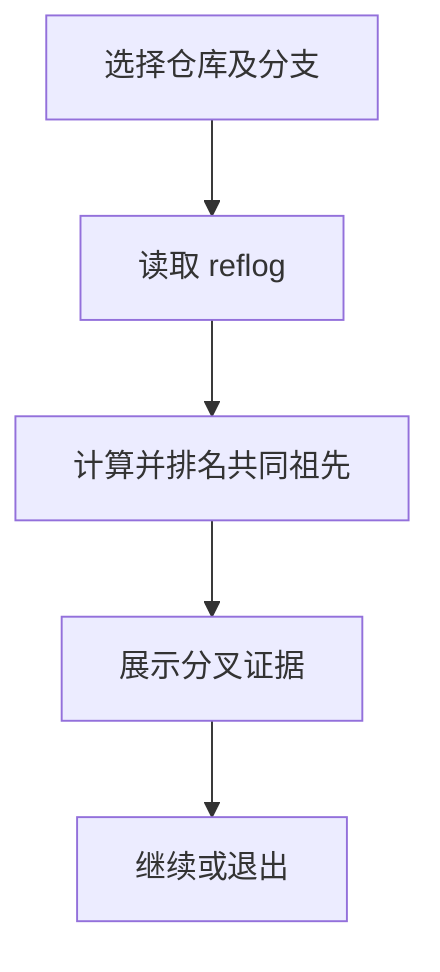

# `【MacOS】🔍Git寻找分支最近的一次原始切点.command`


<!-- jobs-toc:start -->
<!-- jobs-toc:source {"v":2,"token":"[toc]"} -->
<details>
<summary>📚 目录（点击展开 / 收起）</summary>

- [🔥 前言](#jobs-toc-heading-1)
- [一、功能覆盖](#jobs-toc-heading-2)
- [二、运行方式](#jobs-toc-heading-3)
- [三、输入、选项与结果](#jobs-toc-heading-4)
- [四、环境与依赖](#jobs-toc-heading-5)
- [五、副作用、限制与日志](#jobs-toc-heading-6)
- [六、操作流程](#jobs-toc-heading-7)

</details>
<!-- jobs-toc:end -->

## <span id="jobs-toc-heading-1" data-jobs-toc="v2">🔥 <font id=前言>前言</font></span><!-- jobs-toc:heading-end -->

- 采用 Shell 脚本的原因：Shell 来自 [**macOS**](https://www.apple.com/macos/) 原生系统底层，虽然写法相对繁琐冗杂，但执行效率高，并且不需要额外介入 [**Ruby**](https://www.ruby-lang.org)、[**Python**](https://www.python.org) 等第三方运行环境，因此具备更好的移植性。
- 本自述文件对应脚本：`【MacOS】🔍Git寻找分支最近的一次原始切点.command`。
- 脚本位置：本目录中的同名 `.command`，从当前 README 所在目录运行。
- 脚本定位：结合本机 reflog 与 Git 拓扑，推断目标分支父分支及分叉提交。

## <span id="jobs-toc-heading-2" data-jobs-toc="v2">一、功能覆盖 <a href="#前言" style="font-size:17px; color:green;"><b>🔼</b></a> <a href="#🔚" style="font-size:17px; color:green;"><b>🔽</b></a></span><!-- jobs-toc:heading-end -->

| 范围 | 当前能力 |
| --- | --- |
| 目标 | 结合本机 reflog 与 Git 拓扑，推断目标分支父分支及分叉提交。 |
| 能力 | 输入 / 拖入仓库；回车默认脚本目录，要求 `.git` 目录或指针；从本地、远端跟踪分支中选目标；有 fzf 时选择，缺失或取消可手输分支名。 |
| 说明入口 | [同名主脚本](./【MacOS】🔍Git寻找分支最近的一次原始切点.command) |

## <span id="jobs-toc-heading-3" data-jobs-toc="v2">二、运行方式 <a href="#前言" style="font-size:17px; color:green;"><b>🔼</b></a> <a href="#🔚" style="font-size:17px; color:green;"><b>🔽</b></a></span><!-- jobs-toc:heading-end -->

推荐双击 `.command` 运行。终端方式如下：

```shell
chmod +x './【MacOS】🔍Git寻找分支最近的一次原始切点.command'
'./【MacOS】🔍Git寻找分支最近的一次原始切点.command'
```

脚本启动后显示内置说明并等待回车。后续选择与确认以本 README 的实际功能和副作用章节为准。

## <span id="jobs-toc-heading-4" data-jobs-toc="v2">三、输入、选项与结果 <a href="#前言" style="font-size:17px; color:green;"><b>🔼</b></a> <a href="#🔚" style="font-size:17px; color:green;"><b>🔽</b></a></span><!-- jobs-toc:heading-end -->

> **目的：** 结合本机 reflog 与 Git 拓扑，推断目标分支父分支及分叉提交。

- 输入 / 拖入仓库；回车默认脚本目录，要求 `.git` 目录或指针。
- 从本地、远端跟踪分支中选目标；有 fzf 时选择，缺失或取消可手输分支名。
- 读取目标本地分支最早保留的 reflog，尝试提取 Created from / checkout 来源线索。
- 逐个候选执行 `merge-base --fork-point`，失败回落 `merge-base`；按分叉时间和候选第一父链距离评分。
- 输出推测父分支、分叉提交详情、分叉后首个独有提交、ahead / behind 和 first-parent 提交数。
- 回车继续分析同仓其它分支，`c` 更换仓库，`q` 退出。

## <span id="jobs-toc-heading-5" data-jobs-toc="v2">四、环境与依赖 <a href="#前言" style="font-size:17px; color:green;"><b>🔼</b></a> <a href="#🔚" style="font-size:17px; color:green;"><b>🔽</b></a></span><!-- jobs-toc:heading-end -->

需要 Git、Perl、sed、sort 和交互 TTY；fzf 可选。没有精确锁定原始分支来源的保证。

## <span id="jobs-toc-heading-6" data-jobs-toc="v2">五、副作用、限制与日志 <a href="#前言" style="font-size:17px; color:green;"><b>🔼</b></a> <a href="#🔚" style="font-size:17px; color:green;"><b>🔽</b></a></span><!-- jobs-toc:heading-end -->

- reflog 仅反映当前机器保留的记录；自动排名是启发式推断，多次合并和改写历史时需要人工核对。
- 只读本地引用，不联网、不 fetch、不修改分支或工作区；远端跟踪分支可能过期。
- 日志为系统临时目录中的 `【MacOS】🔍Git寻找分支最近的一次原始切点.log`，以脚本结束时打印的实际位置为准。脚本未保证业务命令全部 stdout / stderr 都写入日志。
- 本文按源码静态核对；没有执行真实创建、安装、删除、提交、密钥配置或远端操作。

## <span id="jobs-toc-heading-7" data-jobs-toc="v2">六、操作流程 <a href="#前言" style="font-size:17px; color:green;"><b>🔼</b></a> <a href="#🔚" style="font-size:17px; color:green;"><b>🔽</b></a></span><!-- jobs-toc:heading-end -->



<a id="🔚" href="#前言" style="font-size:17px; color:green; font-weight:bold;">我是有底线的➤点我回到首页</a>
