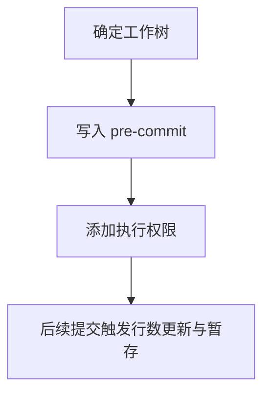

# `【MacOS】🧮双击统计MD文件的有效行数.command`


<!-- jobs-toc:start -->
<!-- jobs-toc:source {"v":2,"token":"[toc]"} -->
<details>
<summary>📚 目录（点击展开 / 收起）</summary>

- [🔥 前言](#jobs-toc-heading-1)
- [一、功能覆盖](#jobs-toc-heading-2)
- [二、运行方式](#jobs-toc-heading-3)
- [三、输入、选项与结果](#jobs-toc-heading-4)
- [四、环境与依赖](#jobs-toc-heading-5)
- [五、副作用、限制与日志](#jobs-toc-heading-6)
- [六、操作流程](#jobs-toc-heading-7)

</details>
<!-- jobs-toc:end -->

## <span id="jobs-toc-heading-1" data-jobs-toc="v2">🔥 <font id=前言>前言</font></span><!-- jobs-toc:heading-end -->

- 采用 Shell 脚本的原因：Shell 来自 [**macOS**](https://www.apple.com/macos/) 原生系统底层，虽然写法相对繁琐冗杂，但执行效率高，并且不需要额外介入 [**Ruby**](https://www.ruby-lang.org)、[**Python**](https://www.python.org) 等第三方运行环境，因此具备更好的移植性。
- 本自述文件对应脚本：`【MacOS】🧮双击统计MD文件的有效行数.command`。
- 脚本位置：本目录中的同名 `.command`，从当前 README 所在目录运行。
- 脚本定位：安装 pre-commit 钩子，在提交时更新 Markdown 的有效行数标记。

脚本按所属 Git 工作树定位，钩子使用 `git rev-parse --git-path hooks/pre-commit` 返回的实际位置，支持子模块 `.git` 指针；已有钩子时停止并保留原文件。

## <span id="jobs-toc-heading-2" data-jobs-toc="v2">一、功能覆盖 <a href="#前言" style="font-size:17px; color:green;"><b>🔼</b></a> <a href="#🔚" style="font-size:17px; color:green;"><b>🔽</b></a></span><!-- jobs-toc:heading-end -->

| 范围 | 当前能力 |
| --- | --- |
| 目标 | 安装 pre-commit 钩子，在提交时更新 Markdown 的有效行数标记。 |
| 能力 | 定位脚本所在 Git 工作树根，并创建 `.git/hooks/pre-commit`；只有预先包含独占行 `当前总行数：0 行`（数字可不同）的 `.md` 才参与更新。 |
| 说明入口 | [同名主脚本](./【MacOS】🧮双击统计MD文件的有效行数.command) |

## <span id="jobs-toc-heading-3" data-jobs-toc="v2">二、运行方式 <a href="#前言" style="font-size:17px; color:green;"><b>🔼</b></a> <a href="#🔚" style="font-size:17px; color:green;"><b>🔽</b></a></span><!-- jobs-toc:heading-end -->

推荐双击 `.command` 运行。终端方式如下：

```shell
chmod +x './【MacOS】🧮双击统计MD文件的有效行数.command'
'./【MacOS】🧮双击统计MD文件的有效行数.command'
```

脚本启动后显示内置说明并等待回车。后续选择与确认以本 README 的实际功能和副作用章节为准。

## <span id="jobs-toc-heading-4" data-jobs-toc="v2">三、输入、选项与结果 <a href="#前言" style="font-size:17px; color:green;"><b>🔼</b></a> <a href="#🔚" style="font-size:17px; color:green;"><b>🔽</b></a></span><!-- jobs-toc:heading-end -->

> **目的：** 安装 pre-commit 钩子，在提交时更新 Markdown 的有效行数标记。

- 定位脚本所在 Git 工作树根，用 `git rev-parse --git-path hooks/pre-commit` 解析真实钩子路径，兼容 `.git` 指针。
- 只有预先包含独占行 `当前总行数：0 行`（数字可不同）的 `.md` 才参与更新。
- 每次提交时递归 find `.md`，排除空行、以 # 开头的行与三反引号围栏行后计算行数；围栏内正文仍计数。
- 用 macOS sed 原地替换标记，并对改过的每份文档执行 `git add`。
- 安装完成显示钩子文件属性；当前运行只安装钩子，不立即创建 Git 提交。

## <span id="jobs-toc-heading-5" data-jobs-toc="v2">四、环境与依赖 <a href="#前言" style="font-size:17px; color:green;"><b>🔼</b></a> <a href="#🔚" style="font-size:17px; color:green;"><b>🔽</b></a></span><!-- jobs-toc:heading-end -->

需要 Git、macOS sed、grep、find、wc；需要 Git 返回的实际 hook 路径可写；已有钩子须先人工整合。

## <span id="jobs-toc-heading-6" data-jobs-toc="v2">五、副作用、限制与日志 <a href="#前言" style="font-size:17px; color:green;"><b>🔼</b></a> <a href="#🔚" style="font-size:17px; color:green;"><b>🔽</b></a></span><!-- jobs-toc:heading-end -->

- 发现已有 pre-commit 或同路径符号链接即停止，保留原钩子；需要整合时手工合并，不自动覆盖。
- 钩子递归扫描未配置依赖排除，使用空白分词的 find 结果；含空格文件名不能认为已受支持。
- 提交时自动整文件暂存可能带入原本未暂存的正文；部分暂存文档使用前须人工核对。
- 该脚本计算的是所述过滤行数，并非 Markdown AST 正文行数；不直接统计每个标题或代码语言。
- 日志为系统临时目录中的 `【MacOS】🧮双击统计MD文件的有效行数.log`，以脚本结束时打印的实际位置为准。脚本未保证业务命令全部 stdout / stderr 都写入日志。
- 本文按源码静态核对；没有执行真实创建、安装、删除、提交、密钥配置或远端操作。

## <span id="jobs-toc-heading-7" data-jobs-toc="v2">六、操作流程 <a href="#前言" style="font-size:17px; color:green;"><b>🔼</b></a> <a href="#🔚" style="font-size:17px; color:green;"><b>🔽</b></a></span><!-- jobs-toc:heading-end -->



<a id="🔚" href="#前言" style="font-size:17px; color:green; font-weight:bold;">我是有底线的➤点我回到首页</a>
