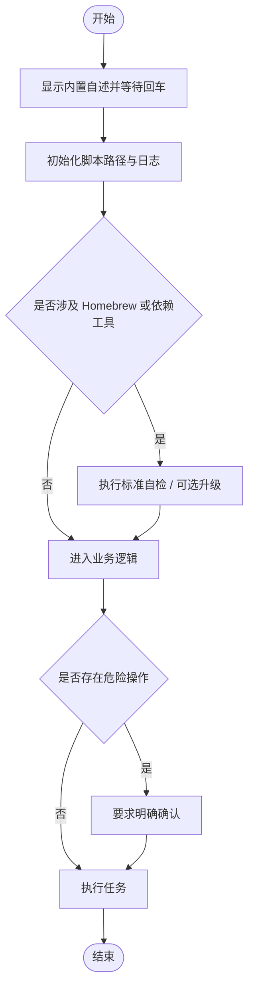

# `【MacOS】⏬下载配置当前Git子模块.command`


[toc]

## 🔥 <font id=前言>前言</font>

- 采用 Shell 脚本的原因：Shell 来自 [**macOS**](https://www.apple.com/macos/) 原生系统底层，虽然写法相对繁琐冗杂，但执行效率高，并且不需要额外介入 [**Ruby**](https://www.ruby-lang.org)、[**Python**](https://www.python.org) 等第三方运行环境，因此具备更好的移植性。

- 本自述文件对应脚本：`【MacOS】⏬下载配置当前Git子模块.command`。
- 脚本原始位置：`JobsGenesis@JobsCommand.Gits`。
- 脚本定位：按父仓选定远端下载、登记和同步 Git 子模块。
- 本次已按 Jobs 标准升级：`# shell: zsh`、README 防误触、彩色日志、结构化入口、`main "$@"` 收口。
- 普通安装 / 更新 / 升级交互统一为：**回车跳过，输入任意字符后回车执行**。
- 危险操作不应该靠回车默认执行；涉及破坏性修改时，应单独输入 `YES` 确认。

<strong id="submodule-quick-look">先看例子：同一份子模块配置，跟着父仓走不同平台</strong>

以下用 `JobsGenesis` 父仓中已有的 `JobsCommand@Flutter` 子模块演示本通用工具的地址规则。

以前固定到 [**GitHub**](https://github.com)：

```ini
url = https://github.com/JobsKits/JobsCommand-Flutter.git
```

共享配置使用相对地址后：

```ini
[submodule "JobsCommand@Flutter"]
    path = JobsCommand@Flutter
    url = ../JobsCommand-Flutter.git
    branch = main
```

同一条 `url` 根据父仓地址解析，支持 [**Gitee**](https://gitee.com) 和任意自建平台；自建地址仅作示例：

| 所选父仓 remote 地址 | 子仓实际地址 |
| --- | --- |
| `https://github.com/JobsKits/JobsGenesis.git` | `https://github.com/JobsKits/JobsCommand-Flutter.git` |
| `https://gitee.com/JobsGo/JobsGenesis.git` | `https://gitee.com/JobsGo/JobsCommand-Flutter.git` |
| `ssh://git@git.example.com:2222/team/tools/JobsGenesis.git` | `ssh://git@git.example.com:2222/team/tools/JobsCommand-Flutter.git` |

`path` 是本地目录名，`url` 中必须写真实远端仓名；`JobsCommand@Flutter` 与 `JobsCommand-Flutter.git` 可以不同。目标平台必须已有子仓镜像，并包含父仓 gitlink 指定的提交。

本下载脚本用 `REMOTE_NAME` 选择父仓线路，默认 `origin`；例如父仓已有 `gitee` remote 时，`REMOTE_NAME=gitee` 让相对 URL 按该地址解析。已有绝对 URL 例外仍按其明确地址下载，脚本保留它，不会因选了 `gitee` 就强行替换。新登记缺少目标平台真实地址证据时会停止；完整参数见[多平台子模块地址](#submodule-address-rules)。

**下载脚本的 Gitee 传输规则：** `【MacOS】⏬下载配置当前Git子模块.command` 在本次运行中，将 `git@gitee.com:`、`ssh://git@gitee.com/`、`ssh://git@gitee.com:22/` 开头的标准地址统一通过 `https://gitee.com/` 访问，保留账号、真实仓名和分支；即使设置 `GIT_URL_STYLE=ssh`，这类 Gitee 地址仍使用 HTTPS。首次 `clone --recurse-submodules` 和后续递归同步都继承该规则，历史子模块中的 SSH 地址无需新电脑先配置 SSH 密钥。

规则通过追加进程级 `GIT_CONFIG_COUNT` / `url.https://gitee.com/.insteadOf` 配置传给子进程，不写入全局 Git 配置，也不依赖其它工程路径。GitHub、其它主机及非 `22` 的自定义 SSH 端口保持原规则。克隆或递归更新失败会返回非零状态，停止本轮同步并保留错误；不会再输出该项同步成功。原有清单、浅克隆参数和全量模式的删除重建策略保留。

## 一、脚本用途 <a href="#前言" style="font-size:17px; color:green;"><b>🔼</b></a> <a href="#🔚" style="font-size:17px; color:green;"><b>🔽</b></a>

| 项目 | 说明 |
|---|---|
| 脚本名称 | `【MacOS】⏬下载配置当前Git子模块.command` |
| 所属目录 | `JobsGenesis@JobsCommand.Gits` |
| 主要标签 | `Git` |
| 是否涉及 Homebrew | `是` |
| 是否可能联网 | `是` |
| 是否含高风险命令 | `是` |
| zsh 静态检查 | `已通过 zsh -n，未执行真实下载` |

## 二、运行方式 <a href="#前言" style="font-size:17px; color:green;"><b>🔼</b></a> <a href="#🔚" style="font-size:17px; color:green;"><b>🔽</b></a>

推荐双击 `.command` 运行。终端方式如下：

```shell
chmod +x './【MacOS】⏬下载配置当前Git子模块.command'
'./【MacOS】⏬下载配置当前Git子模块.command'
```

脚本启动后会先显示内置自述，并等待回车继续，避免误触执行。

进入“选择指定子模块同步（可多选）”后，用 ↑ / ↓ 移动，按回车（Enter）勾选或取消项目；最后按 **空格键（Space）确认并开始同步**，无需再按回车。列表底部会持续显示操作提示；按 ← 返回上一页。

## 三、本次升级内容 <a href="#前言" style="font-size:17px; color:green;"><b>🔼</b></a> <a href="#🔚" style="font-size:17px; color:green;"><b>🔽</b></a>

- 统一脚本解释器为 `# shell: zsh`。
- 增加 README 展示与回车阻塞，防止双击误操作。
- 增加 Jobs 标准彩色日志函数，日志路径为 `$TMPDIR/脚本名.log`。
- 增加 `SCRIPT_DIR` / `SCRIPT_PATH` 标准路径变量。
- 使用 `main "$@"` 作为统一入口。
- 原业务逻辑保留在 `run_original_logic` 模块内，方便后续继续拆分重构。
- 注入 Homebrew 健康自检标准模块：架构判断、shellenv 注入、当前会话生效、可选更新。
- 已修正常见旧式升级交互文案与直接强制升级命令。

## 四、Homebrew 标准 <a href="#前言" style="font-size:17px; color:green;"><b>🔼</b></a> <a href="#🔚" style="font-size:17px; color:green;"><b>🔽</b></a>

- 已有 Homebrew 时保留原有维护交互，不因目录只读而自动另装。
- [**Homebrew**](https://brew.sh/) 安装路径由用户选择：已有可运行安装时复用；确实需要安装时先强提示，只有精确输入大写 `YES` 才选择系统标准目录，其它输入或直接回车选择当前用户的 `.local/homebrew`。`YES` 只表示选择路径，权限与密码由官方安装器实际处理；有管理员权限也可以选用户目录。选定路径失败立即停止，不自动切换；`Ctrl+C` / 输入结束取消整个任务。
- 用户目录安装需要可用 Git 与 curl；后续系统级软件仍可能要求管理员权限。

## 五、注意事项 <a href="#前言" style="font-size:17px; color:green;"><b>🔼</b></a> <a href="#🔚" style="font-size:17px; color:green;"><b>🔽</b></a>

- 我没有在生成阶段执行脚本里的 macOS 专属命令，例如 `brew`、`pod`、`flutter`、`xcodebuild`、`osascript`、`sudo`、模拟器控制等。
- 首次运行前建议先阅读本 README，再执行脚本。
- 如果脚本涉及工程目录，请确认当前目录或拖入路径正确。
- 如果脚本涉及 Git / CocoaPods / Flutter 依赖更新，建议先提交或备份本地改动。
- 运行日志默认写入：`$TMPDIR/【MacOS】⏬下载配置当前Git子模块.log`。

## 六、流程图 <a href="#前言" style="font-size:17px; color:green;"><b>🔼</b></a> <a href="#🔚" style="font-size:17px; color:green;"><b>🔽</b></a>



## 七、<span id="submodule-address-rules">多平台子模块地址</span> <a href="#前言" style="font-size:17px; color:green;"><b>🔼</b></a> <a href="#🔚" style="font-size:17px; color:green;"><b>🔽</b></a>

- 支持 [**GitHub**](https://github.com)、[**Gitee**](https://gitee.com)、[**GitLab**](https://about.gitlab.com) 和自建 Git 服务器；接受 HTTPS、`git@host:namespace/repo.git` 和 `ssh://git@host:端口/namespace/repo.git`，保留嵌套 namespace 与显式端口。配置中禁止携带 HTTP 用户凭据或 SSH 密码。
- `REMOTE_NAME` 默认 `origin`。已有 `.gitmodules` 的 URL、分支、缺省分支和扩展字段保持原样；`../真实仓名.git` 随所选父 remote 的平台、namespace、协议与端口解析，仓名不从本地目录猜测。
- 新条目依据真实子仓 remote 与父 remote 的对应关系生成相对 URL。已知镜像仓名不同、跨组织或端口不匹配时保留已确认的绝对地址；缺少目标平台地址证据时停止并提示在 `.gitmodules` 配置真实 URL，不自动退回其它平台。
- 递归同步逐层使用各自父仓地址。绝对子仓下面的相对子模块，以该绝对子仓为基准继续解析。
- Gitee 标准地址统一使用 HTTPS；其它地址在 `GIT_URL_STYLE=auto` 时保留实际地址，显式指定 `https` 或 `ssh` 只转换无歧义地址，无法推断跨协议端口时停止。`AUTO_PARENT_COMMIT` 默认 `1`，`AUTO_PARENT_PUSH` 默认 `0`；需要只同步并保留修改待检查时，将自动提交设为 `0`。

父仓已配置名为 `gitee` 的 remote 时，可以在脚本所在目录运行：

```shell
REMOTE_NAME=gitee \
AUTO_PARENT_COMMIT=0 \
./【MacOS】⏬下载配置当前Git子模块.command
```

普通 `git clone --recurse-submodules` 由 Git 依据父仓默认 remote 解析相对 URL；`REMOTE_NAME` 是本脚本的线路选择参数。

### （一）离线回归验证 <a href="#前言" style="font-size:17px; color:green;"><b>🔼</b></a> <a href="#🔚" style="font-size:17px; color:green;"><b>🔽</b></a>

需要 `python3`、`zsh` 和 `git`，并保留 JobsGenesis 工作树内全部 7 份入口的目录结构。在本脚本与 `README.md` 所在目录运行：

```shell
python3 \
  ./tests/test_gitee_https_transport.py
```

测试只允许 `file://` 协议，在临时目录创建带提交的父子仓并执行本地递归克隆，结合隔离 Git 配置和受控命令替身检查提取出的函数，覆盖 Gitee 地址边界、递归子进程继承、已有进程配置保留与失败返回；不启动交互菜单，不访问远端，不修改真实工程工作区或全局 Git 配置。测试通过仅表示离线回归通过，新电脑真实下载仍须使用更新后的入口验收。

<a id="🔚" href="#前言" style="font-size:17px; color:green; font-weight:bold;">我是有底线的➤点我回到首页</a>
