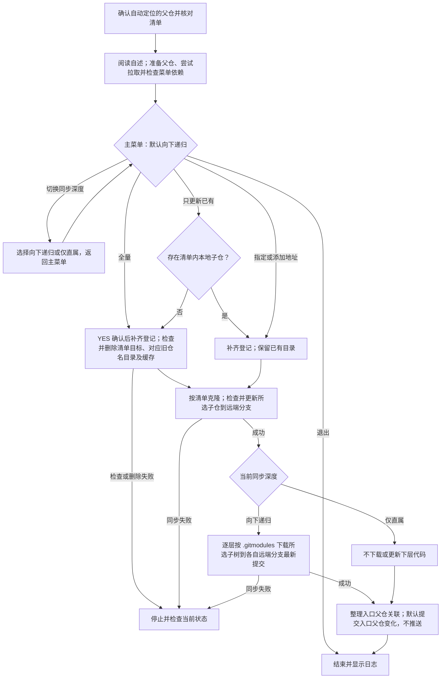

# `【MacOS】⏬下载配置当前Git子模块（可向下同步递归）.command`


<!-- jobs-toc:start -->
<!-- jobs-toc:source {"v":2,"token":"[toc]"} -->
<details>
<summary>📚 目录（点击展开 / 收起）</summary>

- [🔥 前言](#jobs-toc-heading-1)
- [一、快速流程](#quick-flow)
- [二、脚本用途](#jobs-toc-heading-3)
- [三、运行方式](#jobs-toc-heading-4)
- [四、脚本结构](#jobs-toc-heading-5)
- [五、Homebrew 标准](#jobs-toc-heading-6)
- [六、注意事项](#jobs-toc-heading-7)
- [七、流程图](#jobs-toc-heading-8)
- [八、多平台子模块地址](#submodule-address-rules)
  - [8.1、离线回归验证](#jobs-toc-heading-10)

</details>
<!-- jobs-toc:end -->

## <span id="jobs-toc-heading-1" data-jobs-toc="v2">🔥 <font id=前言>前言</font></span><!-- jobs-toc:heading-end -->

- 采用 Shell 脚本的原因：Shell 来自 [**macOS**](https://www.apple.com/macos/) 原生系统底层，虽然写法相对繁琐冗杂，但执行效率高，并且不需要额外介入 [**Ruby**](https://www.ruby-lang.org)、[**Python**](https://www.python.org) 等第三方运行环境，因此具备更好的移植性。

- 本自述文件对应脚本：`【MacOS】⏬下载配置当前Git子模块（可向下同步递归）.command`。
- 脚本原始位置：`JobsGenesis@JobsCommand.Gits`。
- 脚本定位：按父仓选定远端下载、登记和同步 Git 子模块。
- 本次已按 Jobs 标准升级：`# shell: zsh`、README 防误触、彩色日志、结构化入口、`main "$@"` 收口。
- 普通安装 / 更新 / 升级交互统一为：**回车跳过，输入任意字符后回车执行**。
- 全量删除重建须输入 `YES` 确认；分支对齐仍可能覆盖本地独有提交，运行前核对目标与本地提交。

<strong id="sync-depth">先选范围，再按当前深度向下同步</strong>

主菜单默认显示“向下递归”，通过“切换同步深度”可改为“仅直属子模块”；切换后返回主菜单，全量、已有、多选和添加地址都使用当前深度。退出菜单不要求先选择深度。

| 同步深度 | 实际处理范围 |
| --- | --- |
| 向下递归，默认 | 本层所选子仓，以及各层 `.gitmodules` 登记的全部后代；逐层追踪各自远端目标分支最新提交。 |
| 仅直属子模块 | 只下载或更新本层所选子仓，不下载或更新其内部子模块代码。 |

以脚本所在仓库为起点：脚本位于仓库根目录或直属同名脚本包时都定位到该仓，不向更高父仓扫描。多选只展开勾选项的子树；未登记的嵌套 Git 仓库不接管。深层只下载更新，不自动暂存或提交 gitlink，因此其直接父仓可能保留子模块指针改动；入口父仓仍沿用原有自动提交开关。

仅直属模式限制代码下载更新：已有标准 `.git` 指针时跳过元数据归集；首次将独立 `.git` 目录纳入子模块时，Git 的 `absorbgitdirs` 仍可能整理后代元数据，但不会因此下载下层代码。

<strong id="git-source-log">运行时先看这里：子 Git 从哪里拉取</strong>

以父仓线路为 `https://gitee.com/JobsGo/JobsGenesis.git`、下载 `JobsCommand@iOS` 为例，终端会突出显示完整来源；提交号仅展示成功日志的格式：

```text
━━━━━━━━━━ Git 来源｜首次克隆 ━━━━━━━━━━
📦 仓库：JobsCommand@iOS
🌐 平台 / 主机：Gitee（gitee.com）
📥 拉取地址：https://gitee.com/JobsGo/JobsCommand-iOS.git
━━━━━━━━━━━━━━━━━━━━━━━━━━━━━━━━━━━━━━
ℹ️  克隆分支：main
... Git 原生下载进度 ...
✅ JobsCommand@iOS 已浅同步到 origin/main：17b467d（来源：https://gitee.com/JobsGo/JobsCommand-iOS.git）
```

父仓线路、首次克隆和拉取更新各有来源块；递归模式在取得每层 `.gitmodules` 后，先显示下层子仓来源，再逐项下载更新。每层都使用其直接父仓地址解析相对 URL。平台按地址中的主机识别，不按本地目录名判断。

若 `insteadOf` 改写了 URL，来源块同时列出“解析地址”和“拉取地址”；后者由 `git ls-remote --get-url` 在本地展开，未探测 HTTP 重定向或代理最终出口。首次克隆只读取系统、全局及本次进程的规则，不沿用父仓本地 `insteadOf`；已有子仓拉取读取自身配置，递归子仓也分别按未初始化 / 已初始化采用这两种作用域。新来源块在支持颜色的终端重点显示，写入日志时保留纯文本；URL 凭据与查询参数会脱敏。来源日志位于系统临时目录，文件名为 `【MacOS】⏬下载配置当前Git子模块（可向下同步递归）.log`，Git 原生进度仍以终端输出为准。

## 一、<span id="quick-flow">快速流程</span> <a href="#前言" style="font-size:17px; color:green;"><b>🔼</b></a> <a href="#🔚" style="font-size:17px; color:green;"><b>🔽</b></a>

- 1、在父仓根目录或其直属同名脚本包中运行，确认脚本自动定位的父仓，并核对 `SUBMODULE_REPO_URLS`。

- 2、阅读自述后继续；脚本准备父仓远端与分支，尝试拉取父仓，再检查菜单依赖。
  - 如果父仓有未提交改动，跳过父仓 `pull --rebase`，继续后续流程。

- 3、在主菜单选择同步范围；“切换同步深度”可在默认“向下递归”和“仅直属子模块”之间切换，当前深度适用于各同步动作。
  - 如果选全量模式，须输入 `YES` 确认删除重建，其它输入取消。
  - 如果选“只更新目前已有的”，只处理清单内已存在的子仓；一个也没有时转入全量模式。
  - 如果选“选择指定子模块同步”，勾选后按空格确认。

- 4、先补齐 `.gitmodules` 缺项，再处理目录。
  - 如果选全量模式，清洁检查通过后删除清单目标、对应旧仓名目录及缓存，再按清单重建；其它子仓目录保留。

- 5、克隆缺失子仓，或对已有子仓执行 `fetch → checkout -B → reset --hard`。拉取并强制对齐远端目标分支最新提交：优先使用该层 `.gitmodules` 显式 `branch`，`.` 继承直接父仓分支；未设置时优先 `main`，不存在则使用远端默认分支。
  - 如果子仓有未提交内容，会阻断对应更新或删除；仅有本地独有提交仍可能被重置，全量模式还可能删除其历史。

- 6、按当前深度同步：默认逐层读取所选子仓下的 `.gitmodules`，将已登记后代同步到各自远端目标分支最新提交；仅直属模式不下载或更新下层代码。
  - 只处理本层所选子树，不向上扫描，也不接管未登记的嵌套仓库。
  - 深层只下载更新，不自动暂存或提交其父仓的 gitlink；递归后这些父仓可能显示子模块指针改动，保留待审阅。

- 7、整理入口父仓关联并更新指针；默认有变化就自动提交入口父仓，不自动推送。
  - 如果要保留修改待审查，运行前设置 `AUTO_PARENT_COMMIT=0`；自动推送开关默认 `AUTO_PARENT_PUSH=0`。

**目的：** 下载或更新清单内子仓到所选远端分支的最新提交，并同步父仓记录。

<strong id="submodule-quick-look">先看例子：同一份子模块配置，跟着父仓走不同平台</strong>

以下用 `JobsGenesis` 父仓中已有的 `JobsCommand@Flutter` 子模块演示本通用工具的地址规则。

以前固定到 [**GitHub**](https://github.com)：

```ini
url = https://github.com/JobsKits/JobsCommand-Flutter.git
```

共享配置使用相对地址后：

```ini
[submodule "JobsCommand@Flutter"]
    path = JobsCommand@Flutter
    url = ../JobsCommand-Flutter.git
    branch = main
```

同一条 `url` 根据父仓地址解析，支持 [**Gitee**](https://gitee.com) 和任意自建平台；自建地址仅作示例：

| 所选父仓 remote 地址 | 子仓实际地址 |
| --- | --- |
| `https://github.com/JobsKits/JobsGenesis.git` | `https://github.com/JobsKits/JobsCommand-Flutter.git` |
| `https://gitee.com/JobsGo/JobsGenesis.git` | `https://gitee.com/JobsGo/JobsCommand-Flutter.git` |
| `ssh://git@git.example.com:2222/team/tools/JobsGenesis.git` | `ssh://git@git.example.com:2222/team/tools/JobsCommand-Flutter.git` |

`path` 是本地目录名，`url` 中必须写真实远端仓名；`JobsCommand@Flutter` 与 `JobsCommand-Flutter.git` 可以不同。目标平台必须已有子仓镜像，并包含父仓 gitlink 指定的提交。

本下载脚本用 `REMOTE_NAME` 选择父仓线路，默认 `origin`；例如父仓已有 `gitee` remote 时，`REMOTE_NAME=gitee` 让相对 URL 按该地址解析。已有绝对 URL 例外仍按其明确地址下载，脚本保留它，不会因选了 `gitee` 就强行替换。新登记缺少目标平台真实地址证据时会停止；完整参数见[多平台子模块地址](#submodule-address-rules)。

**下载脚本的 Gitee 传输规则：** `【MacOS】⏬下载配置当前Git子模块（可向下同步递归）.command` 在本次运行中，将 `git@gitee.com:`、`ssh://git@gitee.com/`、`ssh://git@gitee.com:22/` 开头的标准地址统一通过 `https://gitee.com/` 访问，保留账号、真实仓名和分支；即使设置 `GIT_URL_STYLE=ssh`，这类 Gitee 地址仍使用 HTTPS。各层首次克隆和后续拉取都继承该规则，历史子模块中的 SSH 地址无需新电脑先配置 SSH 密钥。

规则通过追加进程级 `GIT_CONFIG_COUNT` / `url.https://gitee.com/.insteadOf` 配置传给子进程，不写入全局 Git 配置，也不依赖其它工程路径。GitHub、其它主机及非 `22` 的自定义 SSH 端口保持原规则。克隆或递归更新失败会返回非零状态，停止本轮同步并保留错误；不会再输出该项同步成功。各仓清单与浅克隆参数保留；全量删除重建须输入 `YES` 确认，范围限定为清单目标及对应旧仓名目录。

## <span id="jobs-toc-heading-3" data-jobs-toc="v2">二、脚本用途 <a href="#前言" style="font-size:17px; color:green;"><b>🔼</b></a> <a href="#🔚" style="font-size:17px; color:green;"><b>🔽</b></a></span><!-- jobs-toc:heading-end -->

| 项目 | 说明 |
|---|---|
| 脚本名称 | `【MacOS】⏬下载配置当前Git子模块（可向下同步递归）.command` |
| 所属目录 | `JobsGenesis@JobsCommand.Gits` |
| 主要标签 | `Git` |
| 是否涉及 Homebrew | `是` |
| 是否可能联网 | `是` |
| 是否含高风险命令 | `是` |
| zsh 静态检查 | `已通过 zsh -n，未执行真实下载` |

## <span id="jobs-toc-heading-4" data-jobs-toc="v2">三、运行方式 <a href="#前言" style="font-size:17px; color:green;"><b>🔼</b></a> <a href="#🔚" style="font-size:17px; color:green;"><b>🔽</b></a></span><!-- jobs-toc:heading-end -->

脚本支持直接放在目标父仓根目录，也支持保留在直属同名脚本包内。此处直接运行会自动定位上层 `JobsCommand@Gits`；先核对内置 `SUBMODULE_REPO_URLS`，避免对错误清单执行全量重建。

准备好后，双击脚本，或在本脚本包目录执行：

```shell
chmod +x './【MacOS】⏬下载配置当前Git子模块（可向下同步递归）.command'
'./【MacOS】⏬下载配置当前Git子模块（可向下同步递归）.command'
```

脚本启动后会先显示内置自述，并等待回车继续，避免误触执行。

进入“选择指定子模块同步（可多选）”后，用 ↑ / ↓ 移动，按回车（Enter）勾选或取消项目；最后按 **空格键（Space）确认并开始同步**，无需再按回车。列表底部会持续显示操作提示；按 ← 返回上一页。

## <span id="jobs-toc-heading-5" data-jobs-toc="v2">四、脚本结构 <a href="#前言" style="font-size:17px; color:green;"><b>🔼</b></a> <a href="#🔚" style="font-size:17px; color:green;"><b>🔽</b></a></span><!-- jobs-toc:heading-end -->

- 使用系统 `/bin/zsh`，先显示内置自述并等待确认。
- `main` 编排环境检查、父仓定位、菜单和同步，各步骤由独立函数完成。
- 每份脚本独立携带依赖自检、来源日志与业务实现；各仓清单保留，共同逻辑保持一致。
- 日志位于系统临时目录，文件名为 `【MacOS】⏬下载配置当前Git子模块（可向下同步递归）.log`。

## <span id="jobs-toc-heading-6" data-jobs-toc="v2">五、Homebrew 标准 <a href="#前言" style="font-size:17px; color:green;"><b>🔼</b></a> <a href="#🔚" style="font-size:17px; color:green;"><b>🔽</b></a></span><!-- jobs-toc:heading-end -->

- 已有 Homebrew 时保留原有维护交互，不因目录只读而自动另装。
- [**Homebrew**](https://brew.sh/) 安装路径由用户选择：已有可运行安装时复用；确实需要安装时先强提示，只有精确输入大写 `YES` 才选择系统标准目录，其它输入或直接回车选择当前用户的 `.local/homebrew`。`YES` 只表示选择路径，权限与密码由官方安装器实际处理；有管理员权限也可以选用户目录。选定路径失败立即停止，不自动切换；`Ctrl+C` / 输入结束取消整个任务。
- 用户目录安装需要可用 Git 与 curl；后续系统级软件仍可能要求管理员权限。

## <span id="jobs-toc-heading-7" data-jobs-toc="v2">六、注意事项 <a href="#前言" style="font-size:17px; color:green;"><b>🔼</b></a> <a href="#🔚" style="font-size:17px; color:green;"><b>🔽</b></a></span><!-- jobs-toc:heading-end -->

- 我没有在生成阶段执行脚本里的 macOS 专属命令，例如 `brew`、`pod`、`flutter`、`xcodebuild`、`osascript`、`sudo`、模拟器控制等。
- 首次运行前建议先阅读本 README，再执行脚本。
- 处理目录由脚本位置自动定位：仓库根目录或直属同名脚本包；不使用拖入路径，运行前确认显示的父仓。
- 全量模式逐项检查后删除清单目标、对应旧仓名目录及缓存，再按清单重建；其它子仓目录保留。
- 如果脚本涉及 Git / CocoaPods / Flutter 依赖更新，建议先提交或备份本地改动。
- 脚本日志写入系统临时目录，文件名为 `【MacOS】⏬下载配置当前Git子模块（可向下同步递归）.log`；新来源块为纯文本，Git 原生进度以终端输出为准。

工作目录缺失但仍有 `modules/` 缓存时，脚本先核验缓存归属，再保留缓存并停止同步，避免创建半成品。先用 Git 恢复子模块工作区，或确认本地历史后选择全量重建，再重试同步。

## <span id="jobs-toc-heading-8" data-jobs-toc="v2">七、流程图 <a href="#前言" style="font-size:17px; color:green;"><b>🔼</b></a> <a href="#🔚" style="font-size:17px; color:green;"><b>🔽</b></a></span><!-- jobs-toc:heading-end -->

流程图中的操作目录均指脚本自动定位的父仓根目录；同步失败会中断本轮，已完成的目录删除或更新可能保留。



## 八、<span id="submodule-address-rules">多平台子模块地址</span> <a href="#前言" style="font-size:17px; color:green;"><b>🔼</b></a> <a href="#🔚" style="font-size:17px; color:green;"><b>🔽</b></a>

- 支持 [**GitHub**](https://github.com)、[**Gitee**](https://gitee.com)、[**GitLab**](https://about.gitlab.com) 和自建 Git 服务器；接受 HTTPS、`git@host:namespace/repo.git` 和 `ssh://git@host:端口/namespace/repo.git`，保留嵌套 namespace 与显式端口。配置中禁止携带 HTTP 用户凭据或 SSH 密码。
- `REMOTE_NAME` 默认 `origin`。已有 `.gitmodules` 的 URL、分支、缺省分支和扩展字段保持原样；`../真实仓名.git` 随所选父 remote 的平台、namespace、协议与端口解析，仓名不从本地目录猜测。
- 新条目依据真实子仓 remote 与父 remote 的对应关系生成相对 URL。已知镜像仓名不同、跨组织或端口不匹配时保留已确认的绝对地址；缺少目标平台地址证据时停止并提示在 `.gitmodules` 配置真实 URL，不自动退回其它平台。
- 递归同步逐层使用各自父仓地址。绝对子仓下面的相对子模块，以该绝对子仓为基准继续解析。
- Gitee 标准地址统一使用 HTTPS；其它地址在 `GIT_URL_STYLE=auto` 时保留实际地址，显式指定 `https` 或 `ssh` 只转换无歧义地址，无法推断跨协议端口时停止。`AUTO_PARENT_COMMIT` 默认 `1`，`AUTO_PARENT_PUSH` 默认 `0`；需要只同步并保留修改待检查时，将自动提交设为 `0`。

父仓已配置名为 `gitee` 的 remote 时，可以在脚本所在目录运行：

```shell
REMOTE_NAME=gitee \
AUTO_PARENT_COMMIT=0 \
./【MacOS】⏬下载配置当前Git子模块（可向下同步递归）.command
```

普通 `git clone --recurse-submodules` 由 Git 依据父仓默认 remote 解析相对 URL；`REMOTE_NAME` 是本脚本的线路选择参数。

### <span id="jobs-toc-heading-10" data-jobs-toc="v2">8.1、离线回归验证 <a href="#前言" style="font-size:17px; color:green;"><b>🔼</b></a> <a href="#🔚" style="font-size:17px; color:green;"><b>🔽</b></a></span><!-- jobs-toc:heading-end -->

需要 `python3`、`zsh` 和 `git`，并保留 `JobsGenesis` 及同级 `JobsBaseConfig` 中 8 份下载入口的目录结构。在本脚本与 `README.md` 所在目录运行：

```shell
python3 \
  -m unittest discover \
  -s ./tests \
  -p 'test_*.py'
```

测试仅在临时仓使用本地协议、隔离 Git 配置与受控命令替身，覆盖地址与来源日志、根目录和脚本包定位、同步深度切换、多层分支递归与所选子树边界、全量 `YES` 确认、缓存归属、异名 section、失败返回及无关暂存内容保留；不访问真实远端，不修改业务仓或全局 Git 配置。测试通过仅表示离线回归通过，新电脑真实下载仍须使用更新后的入口验收。

<a id="🔚" href="#前言" style="font-size:17px; color:green; font-weight:bold;">我是有底线的➤点我回到首页</a>
