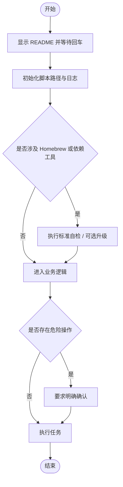

# `【MacOS】⬆️Git添加子模块.command`


[toc]

## 🔥 <font id=前言>前言</font>

- 采用 Shell 脚本的原因：Shell 来自 [**macOS**](https://www.apple.com/macos/) 原生系统底层，虽然写法相对繁琐冗杂，但执行效率高，并且不需要额外介入 [**Ruby**](https://www.ruby-lang.org)、[**Python**](https://www.python.org) 等第三方运行环境，因此具备更好的移植性。

- 本自述文件对应脚本：`【MacOS】⬆️Git添加子模块.command`。
- 脚本原始位置：`JobsGenesis@JobsCommand.Gits`。
- 脚本定位：处理 Git / GitHub / 子模块相关自动化。
- 本次已按 Jobs 标准升级：`# shell: zsh`、README 防误触、彩色日志、结构化入口、`main "$@"` 收口。
- 普通安装 / 更新 / 升级交互统一为：**回车跳过，输入任意字符后回车执行**。
- 危险操作不应该靠回车默认执行；涉及破坏性修改时，应单独输入 `YES` 确认。

<strong id="submodule-quick-look">先看例子：新增子仓跟随父仓平台</strong>

内置清单从固定的 `https://github.com/JobsKits/JobsCommand-Flutter.git` 改为 `../JobsCommand-Flutter.git`。这个旧入口按其既有目录名生成如下记录：

```ini
[submodule "JobsGenesis@JobsCommand.Flutter"]
    path = JobsGenesis@JobsCommand.Flutter
    url = ../JobsCommand-Flutter.git
    branch = main
```

| 父仓地址示例 | 子仓解析地址 |
| --- | --- |
| `https://github.com/JobsKits/JobsGenesis.git` | `https://github.com/JobsKits/JobsCommand-Flutter.git` |
| `https://gitee.com/JobsGo/JobsGenesis.git` | `https://gitee.com/JobsGo/JobsCommand-Flutter.git` |
| `ssh://git@git.example.com:2222/team/JobsGenesis.git` | `ssh://git@git.example.com:2222/team/JobsCommand-Flutter.git` |

`path` 是本地目录，`url` 是真实远端仓名；[**GitHub**](https://github.com)、[**Gitee**](https://gitee.com)、[**GitLab**](https://gitlab.com) 或自建服务都按父仓地址解析。自建服务行仅说明地址结构，不代表已部署；目标平台须已有对应子仓和所需提交，添加分支默认 `main`，可通过 `SUBMODULE_BRANCH` 指定。

**此入口仍包含全量重建、提交和推送流程。** 已有父子仓的日常增量关联使用 [更新 gitmodules](../【MacOS】🧾更新gitmodules.command/README.md)。总仓当前使用的 `JobsCommand@Flutter` 目录与上述旧入口的目录名不同，完整对照见 [JobsGenesis README](../../README.md#submodule-quick-look)。

## 一、脚本用途 <a href="#前言" style="font-size:17px; color:green;"><b>🔼</b></a> <a href="#🔚" style="font-size:17px; color:green;"><b>🔽</b></a>

| 项目 | 说明 |
|---|---|
| 脚本名称 | `【MacOS】⬆️Git添加子模块.command` |
| 所属目录 | `JobsGenesis@JobsCommand.Gits` |
| 主要标签 | `Git` |
| 是否涉及 Homebrew | `否` |
| 是否可能联网 | `是` |
| 是否含高风险命令 | `是` |
| zsh 静态检查 | `当前生成环境未执行，请在 macOS 上复核` |

## 二、运行方式 <a href="#前言" style="font-size:17px; color:green;"><b>🔼</b></a> <a href="#🔚" style="font-size:17px; color:green;"><b>🔽</b></a>

推荐双击 `.command` 运行。终端方式如下：

```shell
chmod +x './【MacOS】⬆️Git添加子模块.command'
'./【MacOS】⬆️Git添加子模块.command'
```

脚本启动后会先显示本 README，并等待回车继续，避免误触执行。

## 三、本次升级内容 <a href="#前言" style="font-size:17px; color:green;"><b>🔼</b></a> <a href="#🔚" style="font-size:17px; color:green;"><b>🔽</b></a>

- 统一脚本解释器为 `# shell: zsh`。
- 增加 README 展示与回车阻塞，防止双击误操作。
- 增加 Jobs 标准彩色日志函数，日志路径为 `$TMPDIR/脚本名.log`。
- 增加 `SCRIPT_DIR` / `SCRIPT_PATH` 标准路径变量。
- 使用 `main "$@"` 作为统一入口。
- 原业务逻辑保留在 `run_original_logic` 模块内，方便后续继续拆分重构。

## 四、Homebrew 标准 <a href="#前言" style="font-size:17px; color:green;"><b>🔼</b></a> <a href="#🔚" style="font-size:17px; color:green;"><b>🔽</b></a>

- 已有 Homebrew 时保留原有维护交互，不因目录只读而自动另装。
- [**Homebrew**](https://brew.sh/) 安装路径由用户选择：已有可运行安装时复用；确实需要安装时先强提示，只有精确输入大写 `YES` 才选择系统标准目录，其它输入或直接回车选择当前用户的 `.local/homebrew`。`YES` 只表示选择路径，权限与密码由官方安装器实际处理；有管理员权限也可以选用户目录。选定路径失败立即停止，不自动切换；`Ctrl+C` / 输入结束取消整个任务。
- 用户目录安装需要可用 Git 与 curl；后续系统级软件仍可能要求管理员权限。

## 五、注意事项 <a href="#前言" style="font-size:17px; color:green;"><b>🔼</b></a> <a href="#🔚" style="font-size:17px; color:green;"><b>🔽</b></a>

- 内置新增清单使用 `../仓库名.git`，跟随父仓默认远端的平台、账号和协议，支持 [**Git**](https://git-scm.com/) 可用的托管服务。目标平台须已存在相同仓名与所需提交；脚本不会自动创建镜像。默认添加分支为 `main`，可用环境变量 `SUBMODULE_BRANCH` 指定实际分支。
- 这个旧入口包含清理全部既有子模块、提交和推送流程。已有父子仓的日常增量关联使用同级 `../【MacOS】🧾更新gitmodules.command/` 中的入口；不要用重建流程切换平台。
- 我没有在生成阶段执行脚本里的 macOS 专属命令，例如 `brew`、`pod`、`flutter`、`xcodebuild`、`osascript`、`sudo`、模拟器控制等。
- 首次运行前建议先阅读本 README，再执行脚本。
- 如果脚本涉及工程目录，请确认当前目录或拖入路径正确。
- 如果脚本涉及 Git / CocoaPods / Flutter 依赖更新，建议先提交或备份本地改动。
- 运行日志默认写入：`$TMPDIR/【MacOS】⬆️Git添加子模块.log`。

## 六、流程图 <a href="#前言" style="font-size:17px; color:green;"><b>🔼</b></a> <a href="#🔚" style="font-size:17px; color:green;"><b>🔽</b></a>



<a id="🔚" href="#前言" style="font-size:17px; color:green; font-weight:bold;">我是有底线的➤点我回到首页</a>
