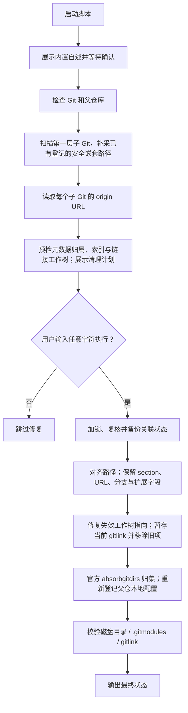

# `【MacOS】🧭更新引用Git父仓=>子仓.command`


<!-- jobs-toc:start -->
<!-- jobs-toc:source {"v":2,"token":"[toc]"} -->
<details>
<summary>📚 目录（点击展开 / 收起）</summary>

- [🔥 前言](#jobs-toc-heading-1)
- [一、快速流程](#quick-flow)
- [二、适用场景](#jobs-toc-heading-3)
- [三、会修改什么](#jobs-toc-heading-4)
- [四、运行方式](#jobs-toc-heading-5)
- [五、执行前检查](#jobs-toc-heading-6)
- [六、流程图](#jobs-toc-heading-7)
- [七、日志文件](#jobs-toc-heading-8)
- [八、风险说明](#jobs-toc-heading-9)
- [九、常见问题](#jobs-toc-heading-10)

</details>
<!-- jobs-toc:end -->

---

## <span id="jobs-toc-heading-1" data-jobs-toc="v2">🔥 <font id=前言>前言</font></span><!-- jobs-toc:heading-end -->

- 这个脚本用于修复父 [**GitHub**](https://github.com) / Git 仓库管理多个子 Git 时，目录改名后引发的子模块元数据错位问题。
- 脚本以第一层现存子 Git，以及 `.gitmodules` 已登记且路径安全的现存嵌套子 Git 为基准，对齐 `.gitmodules`、父仓库 gitlink、本地 `.git/config` 和子目录 `.git` 指针。
- 脚本会自动定位目标父 Git 仓库：优先处理脚本所在目录上一层的 Git 仓库；如果脚本直接放在 Git 根目录，则处理当前目录。
- 在当前“一脚本一目录”结构中，目标父仓库就是：

  ```shell
  ..
  ```

## 一、<span id="quick-flow">快速流程</span> <a href="#前言" style="font-size:17px; color:green;"><b>🔼</b></a> <a href="#🔚" style="font-size:17px; color:green;"><b>🔽</b></a>

- 1、阅读自述并确认目标父仓；此包内入口定位上层 `JobsCommand@Gits`，放在父仓根目录时处理该根目录。

- 2、扫描父仓第一层现存子 Git，并补采已有登记的安全嵌套路径；预检远端、索引与元数据归属，展示修复和清理计划。
  - 指针破损、元数据冲突、链接工作树、符号链接路径或中途跨过其它 Git 工作树时停止，不覆盖。

- 3、确认按磁盘现状修复，备份关联配置与索引；直接回车跳过，输入任意字符后回车执行。
  - `--dry-run`：只预检和预览，不改关联。

- 4、对齐 `.gitmodules`，保留仍存在条目的 URL、分支和扩展字段，移除缺失路径的登记。
  - 如果某个已登记子模块尚未下载或暂时移走，也会被当作缺失项清理。

- 5、修复可证明失效的工作树指向，移除旧 gitlink 并暂存现存子仓当前 `HEAD`，用官方 `absorbgitdirs` 归集元数据，再补齐父仓本地登记。

- 6、核验磁盘、登记和父仓指针并输出状态；保留子仓真实 `origin`、分支与提交，不拉取代码、不提交、不推送。

**目的：** 让父仓子模块关联与当前磁盘目录及子仓提交一致。

<strong id="submodule-quick-look">先看例子：修复本地关联，同时保留多平台地址</strong>

以下用 `JobsGenesis` 父仓中已有的 `JobsCommand@Flutter` 子模块演示本通用工具的地址规则。以前固定到 GitHub：

```ini
url = https://github.com/JobsKits/JobsCommand-Flutter.git
```

共享配置使用相对地址后：

```ini
[submodule "JobsCommand@Flutter"]
    path = JobsCommand@Flutter
    url = ../JobsCommand-Flutter.git
    branch = main
```

同一条 `url` 根据父仓默认 remote 地址解析，支持 [**Gitee**](https://gitee.com) 和任意自建平台；自建地址仅作示例：

| 父仓默认 remote 地址 | 子仓实际地址 |
| --- | --- |
| `https://github.com/JobsKits/JobsGenesis.git` | `https://github.com/JobsKits/JobsCommand-Flutter.git` |
| `https://gitee.com/JobsGo/JobsGenesis.git` | `https://gitee.com/JobsGo/JobsCommand-Flutter.git` |
| `ssh://git@git.example.com:2222/team/tools/JobsGenesis.git` | `ssh://git@git.example.com:2222/team/tools/JobsCommand-Flutter.git` |

`path` 是本地目录名，`url` 中必须写真实远端仓名；`JobsCommand@Flutter` 与 `JobsCommand-Flutter.git` 可以不同。目标平台必须已有子仓镜像，并包含父仓 gitlink 指定的提交。

本脚本负责**修复目录与 Git 元数据的对应关系**：已有条目保留 section、URL、branch 和扩展字段；磁盘上已不存在的旧 path 按工具职责移除。新增登记满足全部已配置线路的同站、同命名空间、子仓同名条件时才写相对 URL，否则保留明确原地址。子仓真实 `origin` 仍单独保存，不能把共享的 `../JobsCommand-Flutter.git` 当成它的远端地址。修复不提交、不推送，也不会批量迁移存量固定平台 URL。

普通分类目录可以容纳父仓直接管理的子模块，例如以下路径结构；`url` 按子仓真实远端填写：

```ini
[submodule "windows-extension"]
    path = OS@Extension/WindowsOS@Extension
    url = ../真实仓名.git
```

这里 `OS@Extension` 是普通目录，`windows-extension` 仍是原 section；脚本保留这类已登记且现存的安全嵌套路径。只检查登记中的精确路径，不递归发现同一分类目录里的未登记仓库；路径中的符号链接、元数据 / 依赖 / 供应商目录或中途独立 Git 工作树会阻断修复。已有登记的嵌套路径缺失或没有 `.git` 标记时，仍按缺失关联清理。

## <span id="jobs-toc-heading-3" data-jobs-toc="v2">二、适用场景 <a href="#前言" style="font-size:17px; color:green;"><b>🔼</b></a> <a href="#🔚" style="font-size:17px; color:green;"><b>🔽</b></a></span><!-- jobs-toc:heading-end -->

- 当前磁盘目录名已经是你想要的最终形态，但普通 `git status` 输出和真实目录不一致。
- `.gitmodules` 里残留旧目录名、旧子模块名、重复配置或不存在的路径。
- 子目录 `.git` 文件仍指向旧的 `.git/modules/旧目录名`，导致父仓库执行 `git status`、提交或 SourceTree 刷新时报错。
- 父仓库索引里还残留磁盘上已经不存在的旧 gitlink。

## <span id="jobs-toc-heading-4" data-jobs-toc="v2">三、会修改什么 <a href="#前言" style="font-size:17px; color:green;"><b>🔼</b></a> <a href="#🔚" style="font-size:17px; color:green;"><b>🔽</b></a></span><!-- jobs-toc:heading-end -->

- 会按当前真实子 Git 目录对齐父仓库 `.gitmodules` 的路径清单；按 path 找到仍存在的 section 后，保留其名称、URL、branch 和扩展字段，包括原本未设置 branch 的状态。磁盘上已经不存在的旧 path 继续按本工具的目录对齐职责移除。
- 新增登记只在父子全部已配置托管线路逐一同站同命名空间、子仓同名时使用 `../仓库名.git`，从父仓默认远端继承站点和传输方式。适用于 GitHub、[**Gitee**](https://gitee.com) 和其它已配置平台；支持 HTTPS、scp 风格 SSH、带端口的 `ssh://` 与多层命名空间。
- 跨命名空间、平台异名、映射不全、服务端口或协议无法证明一致时保留明确原地址并提示；本地文件路径和未知协议不转换。脚本不根据目录名猜地址，也不创建远端镜像。子仓真实 `origin` 与 `.gitmodules` 登记 URL 分开保存，修复 Git 元数据不会把登记用的 `../仓库名.git` 写成子仓 `origin`。
- 写入前核验元数据归属并备份关联状态；目录改名时复用可证明属于该子仓的原 section 与元数据目录，不手工搬移或覆盖 gitdir。
- 仅修复可证明失效的 `core.worktree`，普通嵌套 Git 通过官方 `git submodule absorbgitdirs` 归集。
- 会清理父仓库索引里已经不存在于磁盘上的旧 gitlink。
- 会重新登记父仓本地子模块配置并执行 `git submodule init`；保留子仓真实 `origin`，不把共享登记地址覆盖到子仓远端。
- 不会删除当前磁盘上的子 Git 目录。旧 gitlink 使用的是 `git rm --cached`，只移出父仓库索引。

## <span id="jobs-toc-heading-5" data-jobs-toc="v2">四、运行方式 <a href="#前言" style="font-size:17px; color:green;"><b>🔼</b></a> <a href="#🔚" style="font-size:17px; color:green;"><b>🔽</b></a></span><!-- jobs-toc:heading-end -->

- 双击运行：

  ```shell
  【MacOS】🧭更新引用Git父仓=>子仓.command
  ```

- 终端运行：

  ```shell
  chmod +x './【MacOS】🧭更新引用Git父仓=>子仓.command'
  './【MacOS】🧭更新引用Git父仓=>子仓.command'
  ```

- 脚本会先展示内置自述，按回车后进入检查流程。
- 真正执行修复前还会二次询问：直接回车跳过；输入任意字符后回车执行。

## <span id="jobs-toc-heading-6" data-jobs-toc="v2">五、执行前检查 <a href="#前言" style="font-size:17px; color:green;"><b>🔼</b></a> <a href="#🔚" style="font-size:17px; color:green;"><b>🔽</b></a></span><!-- jobs-toc:heading-end -->

- 确认第一层子 Git 和已有登记的嵌套子 Git 路径就是最终想保留的路径；分类目录内未登记的仓库不会递归接管。
- 确认每个子 Git 目录都能找到 `remote.origin.url`。如果某个子目录完全没有远端地址，脚本会停止，避免写坏 `.gitmodules`。
- 如果父仓库里有其它未提交改动，脚本不会回滚；修复完成后需要你自己决定是否一起提交。

## <span id="jobs-toc-heading-7" data-jobs-toc="v2">六、流程图 <a href="#前言" style="font-size:17px; color:green;"><b>🔼</b></a> <a href="#🔚" style="font-size:17px; color:green;"><b>🔽</b></a></span><!-- jobs-toc:heading-end -->



`--dry-run` 只执行预检与计划预览；元数据归属不明、指针破损或链接工作树会在写入前停止。

## <span id="jobs-toc-heading-8" data-jobs-toc="v2">七、日志文件 <a href="#前言" style="font-size:17px; color:green;"><b>🔼</b></a> <a href="#🔚" style="font-size:17px; color:green;"><b>🔽</b></a></span><!-- jobs-toc:heading-end -->

- 日志位于系统临时目录，文件名为 `【MacOS】🧭更新引用Git父仓=>子仓.<进程号>.log`；启动时打印完整路径。
- 确认后将关联配置与索引备份到父仓实际 Git 目录的 `jobs-submodule-backups/reference.*`，终端和日志显示具体位置。
- 修复中断时查看失败阶段和备份位置，核对当前状态后再决定恢复；脚本不会把部分完成报成成功。

## <span id="jobs-toc-heading-9" data-jobs-toc="v2">八、风险说明 <a href="#前言" style="font-size:17px; color:green;"><b>🔼</b></a> <a href="#🔚" style="font-size:17px; color:green;"><b>🔽</b></a></span><!-- jobs-toc:heading-end -->

- 这个脚本会改 Git 元数据，不是纯查看脚本。
- 脚本判断标准是“当前磁盘目录优先”。如果你当前目录名本身还没整理好，请先改目录，再运行脚本。
- 脚本不会执行 `git commit`、`git push`，也不会删除当前子 Git 目录。
- 隔离回归覆盖根目录与脚本包定位、目录改名、空格路径、嵌套登记与 section 异名保留、未登记同级仓排除、符号链接 / 跨仓路径阻断、本地提交与索引保留、缺失登记清理、元数据冲突、链接工作树、预览和迁移失败。在本脚本包目录执行：

  ```shell
  python3 './tests/test_reference_repair.py'
  ```

## <span id="jobs-toc-heading-10" data-jobs-toc="v2">九、常见问题 <a href="#前言" style="font-size:17px; color:green;"><b>🔼</b></a> <a href="#🔚" style="font-size:17px; color:green;"><b>🔽</b></a></span><!-- jobs-toc:heading-end -->

- 如果提示无法读取某个子 Git 的 `origin URL`，进入对应子目录补齐远端：

  ```shell
  git remote add origin git@github.com:JobsKits/仓库名.git
  ```

- 如果修复后仍有父仓库未暂存文件，说明那些是修复前就存在的普通工作区改动，需要单独判断是否提交。
- 如果 `git submodule status --recursive` 能正常列出所有当前子 Git，说明子模块基础配置已经恢复。

<a id="🔚" href="#前言" style="font-size:17px; color:green; font-weight:bold;">我是有底线的➤点我回到首页</a>
